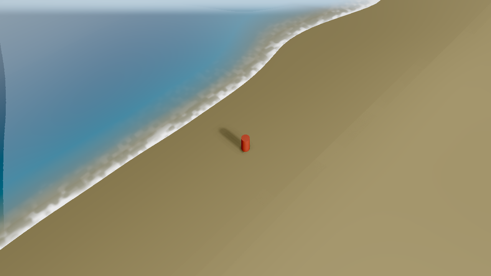
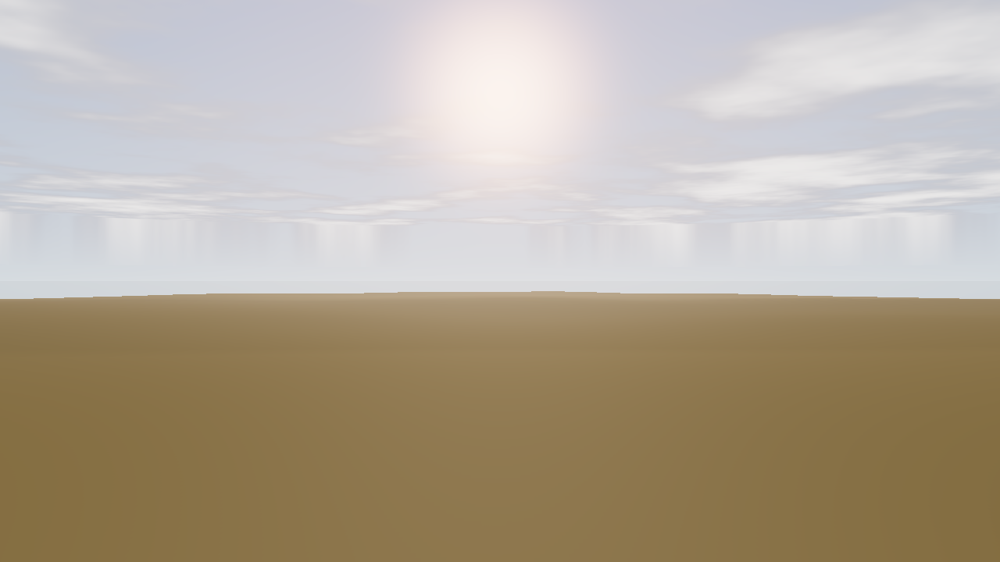
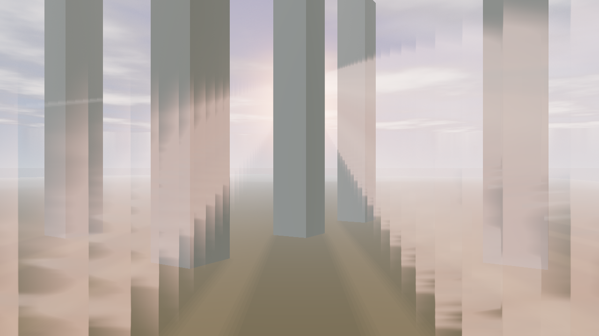
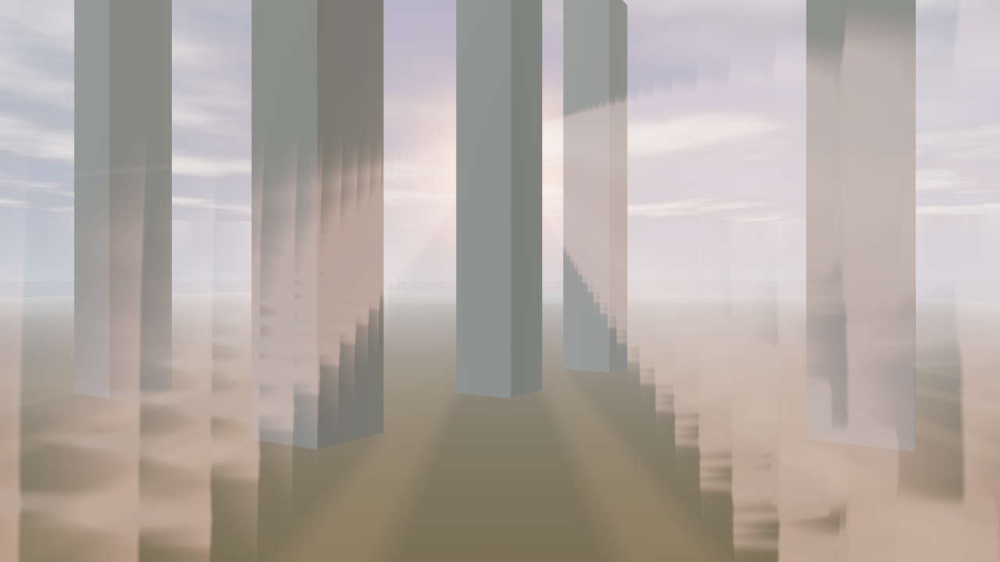

# GodRay / 体积光实现记录

**日期**：2026-11-20  
**状态**：WIP  
**目标**：用光线步进做太阳体积光/云隙光，服务雾天、树林、建筑遮挡。

---

## 参考

- [Unity 体积光与大气散射实战：Raymarching 到 URP 高度雾](https://developer.unity.cn/projects/6ae92a6eedbc2a001d02b4ff)
- [Ninedark9/Volumetric-Light-Shafts](https://github.com/Ninedark9/Volumetric-Light-Shafts-)
- [halby24/LightShaftsUrp](https://github.com/halby24/LightShaftsUrp)
- 视频：拆解云隙光(GodRay)的实现 / 光线步进

---

## 已实现

在 `Fengling/PostProcess` Composite pass 里加 `VolumetricLight(uv)`：

- 用 `_FenglingSceneDepth` 取屏幕深度
- 用 `_FenglingInvProj` / `_FenglingCameraToWorld` 重建世界射线
- 18 步 ray march
- 太阳方向 `_FenglingSunDir`
- 太阳颜色 `_FenglingSunColor`
- 太阳 shadow atlas 遮挡 `_FenglingShadowAtlas` + cascade0 矩阵
- 相位函数 `phase = 0.35 + 0.65 * pow(dot(dir, sunDir), 6)`
- 高度密度：
  `0.55 + 0.45 * exp(-max(0,y) * 0.035)`
- `_FenglingVolumetricDensity` 由天气雾/霾驱动

管线侧：

- `PostProcess` 设置 `_FenglingInvProj` / `_FenglingCameraToWorld` / `_FenglingCameraPos`
- TimeOfDaySystem 设置 `_FenglingVolumetricDensity`

---

## 当前结果

- 后处理函数确认执行
- 体积雾会让画面轻微增亮/发灰
- RpgLab 是平坦海岸，没有树木/建筑遮挡，**看不到明显光柱**
- 光柱需要 caster 遮挡 + 侧视/低机位才能显形

**低机位 QA（2026-11-20）**

- 低机位朝太阳看
- 雾/霾提高体积密度
- 画面出现竖直光柱/散射带

注意：

- 临时高柱遮挡物在截图里没有正确进入画面
- 光柱已经出现，但还不能证明是柱体遮挡产生的
- 下一步需要把遮挡物正确放进镜头并验收“柱间光柱”

**遮挡构图修正（2026-11-20）**

- 柱体改为沿相机视线、太阳方向摆放
- 柱体已正确入镜，地面能看到长阴影
- 但 16:00 高雾把画面洗白，柱间空气光柱仍不可辨
- 当前判断：需要调雾密度/相位和按级联选 shadow，不是继续加遮挡物

**级联选择 + 强度验证（2026-11-20）**

- 体积光 shadow 改为按相机距离选择 4 级 cascade
- `_FenglingShadowSplits` + 4 组 VP/View/Tile
- QA 雾密度从 0.85 降到 0.45
- 强度从 0.35 提到 2.0 做对照
- 结果：强度 2.0 只是把画面整体洗白，**没有柱间差异**
- 说明 post 里的 shadow 采样没有产生遮挡变化，光柱仍不成立
- 强度已收回 0.5，避免洗白

**shadow mask 诊断（2026-11-20）**

- post 里增加 `_FenglingGodRayDebug`
- debug=1 时直接输出 `SampleSunShadow`
- 结果：柱体剪影、地面阴影正确（蓝=遮蔽，红=受光）
- 说明 shadow atlas / 4 级 cascade / 坐标都正确
- ray march 仍没有柱间差异，问题在体积累积/相位/密度，不在 shadow 采样
- 稳定强度收回 0.5

**screen-space radial 兜底（2026-11-20）**

参考成熟实现：

- [Super Rays：multi-iteration ping-pong radial blur](https://assetstore.unity.com/packages/vfx/shaders/fullscreen-camera-effects/super-rays-volumetric-god-rays-sun-shafts-for-urp-370930)
- [Kenny Mitchell, Volumetric Light Scattering as a Post-Process, GDC 2007](https://github.com/makr-code/GalaxyQuest/blob/develop/js/engine/fx/shaders/godray.wgsl)
- [LightShafts：低分辨率 ray march / 避免每像素慢 raymarch](https://github.com/halby24/LightShaftsUrp)
- [NullGraph：screen-space god rays 与 froxel 体积光的成本对比](https://github.com/flarelink-in/NullGraph/blob/master/docs/environment-aerial-design.md)

实现：

- 管线计算太阳屏幕位置 `_FenglingSunScreenPos`
- 从当前像素向太阳做 32 次径向采样
- 亮度阈值 `_FenglingGodRayThreshold`
- 强度 `_FenglingGodRayIntensity`
- 与 ray march 体积光叠加

结果：

- 柱间光柱可见
- 仍有明显采样台阶/块状
- 不是深度正确的体积光，属于视觉兜底

**去抖动平滑（2026-11-20）**

- 逐像素 jitter 会产生明显颗粒噪声
- 去掉 jitter
- 每个径向采样点做 3 次小偏移平均
- 光柱更干净，但仍有轻微台阶/拉伸

---

## 已知问题

1. 只用 cascade0 shadow，远处/级联边界会错
2. 全分辨率 18 步，未做半分辨率/蓝噪声
3. 没有天空深度特殊处理
4. 没有 blue-noise 去 banding
5. RpgLab 缺遮挡体，无法验收光柱
6. 没接六套 Preset 的树林/岩石场景

---

## 下一步

1. 在树林/建筑场景验收光柱
2. 降半分辨率 + 蓝噪声抖动
3. 按 cascade 选 shadow
4. 高度雾/距离雾统一
5. 性能采样

---

## 提交

- `FenglingPostProcess.shader` 增加体积光 pass
- `FenglingPipeline.cs` 传相机矩阵
- `TimeOfDaySystem` 传体积密度
