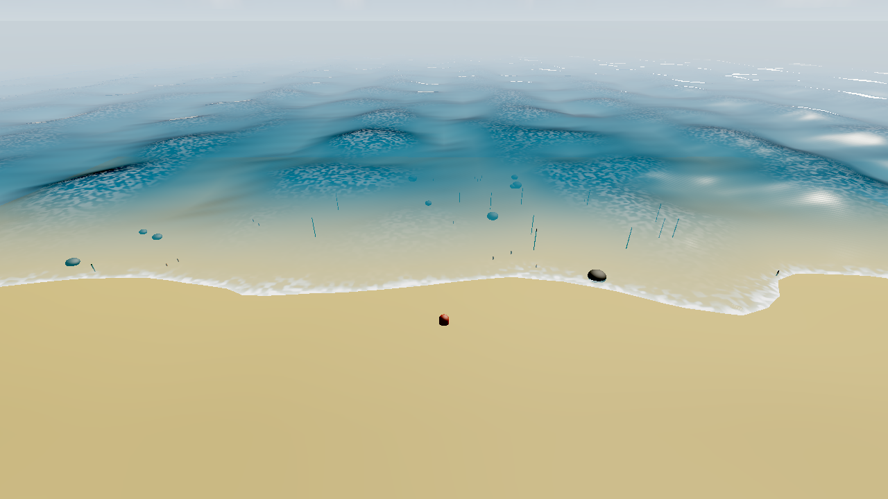
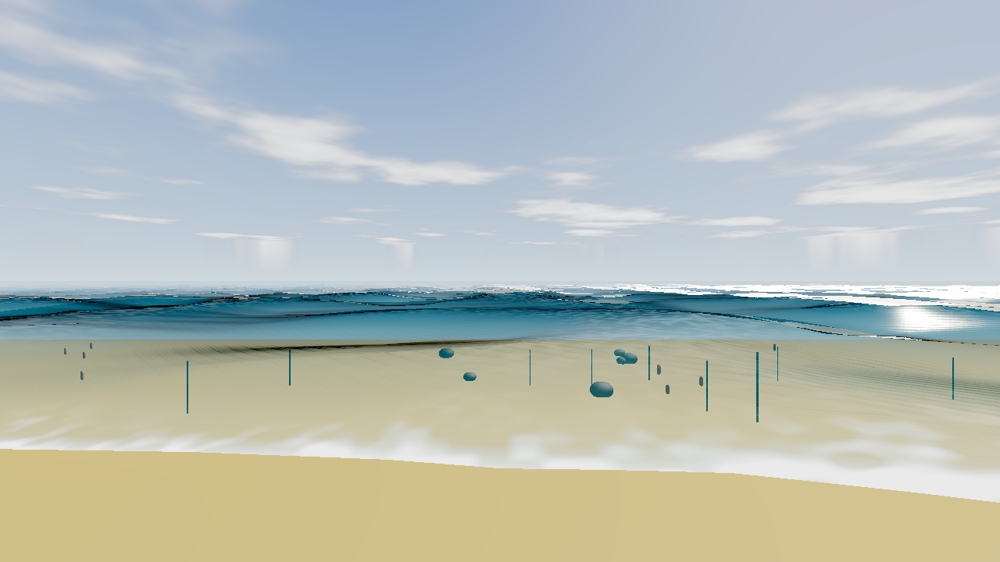
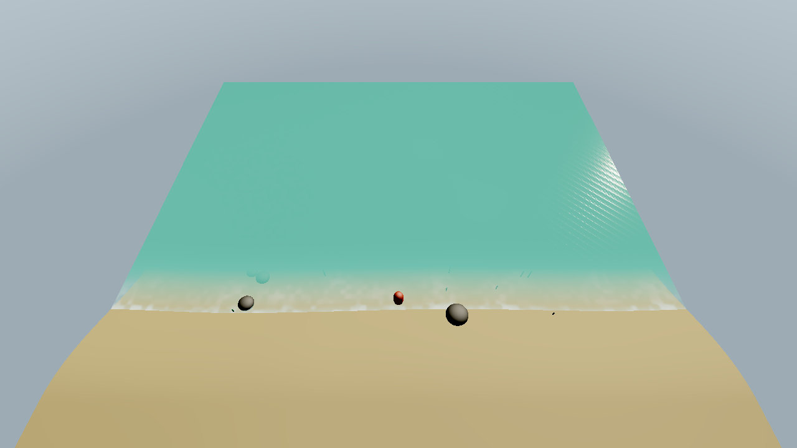
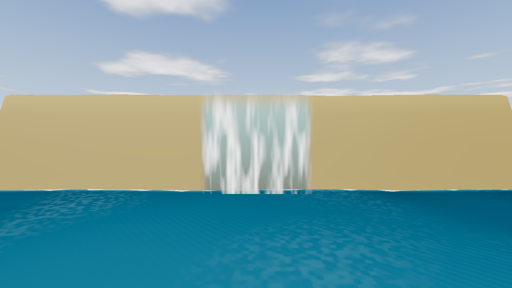

# P0 问题清单与修复方案

**日期**：2026-11-19  
**工程**：`D:\item\game\My project`  
**状态**：P0 已实施到分支 `p0-water-fixes`；`main` 未合并；验证截图见第 9 节。  
**关联报告**：[水体项目全面分析报告](水体项目全面分析报告_2026-11-19.md)

---

## 0. 决策记录（按你的判断）

| 项 | 你的决定 | 对当前工作的约束 |
|---|---|---|
| 优先级 | 先记录问题，防止遗忘，先解决 P0 | 本轮只做 P0 清单和方案，不开新功能 |
| 美术方向 | 多风格；先俯视/等距风格化浅水，之后开阔海平线/远洋 | P0 不能把架构锁死成单一风格；保留 `IWaterSimulation` / `WaterQualityTier` |
| 管线路线 | 先不定，等 P0 修完再说 | P0 不切 HDRP/URP，不引入 Crest |
| 性能目标 | 先不管性能，先出画面 | P0 只记录基线帧时间，不做优化 |
| 改动权限 | 先给方案，不要动工程 | 本文件只新增文档；代码/场景/材质保持原样 |

---

## 1. P0 的定义

**P0 = 让现有 7 个场景“正确显示、可重复截图、可构建”的最小修复。**

不含：

- 真 FFT / 三波段 / LOD
- 平面反射 / SSR / 水下 / 焦散
- 后处理 / 曝光 / 颜色分级
- 管线路线切换（HDRP/URP/Crest）
- 性能优化

P0 完成后，才有资格讨论“下一版水怎么做”。

---

## 2. P0 总表

| ID | 问题 | 根因 | 证据 | 状态 |
|---|---|---|---|---|
| P0-1 | WaterLab 鱼/石头/水草洋红，Player 不显示或发黑 | 场景内嵌材质仍是 HDRP/Lit；`MaterialConverter` 只扫 `.mat` 资产 | [洋红截图](images/waterlab_magenta_props.png)；`WaterLab.unity:1990/2914/3797/4351`；`MaterialConverter.cs:31` | 已完成 |
| P0-2 | 六个预设场景水漫出/露底/没有泡沫和深浅 | `ScenePresets` 没设 `WaterSettings.size`、`heightMap`、`normalMap`；瀑布 sheet 被替换成水平网格 | `ScenePresets.cs:201-202`、`277-294` | 已完成 |
| P0-3 | 12 组波不一定传到 GPU；Console 每帧刷警告 | 运行时 `new Material` 的数组默认长度 1；`SetVectorArray(16)` 被 cap | `WaterSurfaceRenderer.cs:202-203`；Console `_WaveDirs exceeds previous array size (16 vs 1)` | 已完成 |
| P0-4 | 玩家浮力位置和画面水面不一致 | Shader 多了 `irregular` 噪声调制，CPU `Sample()` 没有 | `FenglingWater.shader:200-207`；`SpectralWaterSimulation.cs:93-104`；`GerstnerWaterSimulation.cs:65-81` | 已完成（删除 GPU-only 噪声） |
| P0-5 | 地形整片黑 | 自建阴影图格式/投影/采样错误，地形被误判进阴影 | [黑块截图](images/black_shadow_before_fix.png)；`FenglingShadows.cs:34/51`；提交 `fb11cde` | 已完成临时保护（默认关闭 + 显式复位） |
| P0-6 | 打包后水面可能消失/洋红 | 水面 shader 走 `SRPDefaultUnlit`，但 `renderPipelineShaderTag` 只覆盖 `FenglingForward`；材质是运行时 `Shader.Find` | `FenglingPipelineAsset.cs:25`；`FenglingWater.shader:79/85`；`WaterSurfaceRenderer.cs:90-99` | 已完成材质资产 + tag 修正；**Player 构建未验证** |
| P0-7 | 画面灰/暗、角色正面近黑 | HDRP Volume/Exposure/ACES 被自建管线忽略；默认天空盒；没有后处理/补光 | 诊断：`skybox=Default-Skybox`、`ambientProbe` 很弱；`FenglingPipeline.cs` 无后处理 | 已完成基础后处理（Exposure/ACES/Bloom）+ 程序化天空；画面仍需美术调 |
| P0-8 | 六场景 Waterfall 的“瀑布”是水平面 | `WaterSurfaceRenderer.Awake()` 重建 mesh，覆盖了 Quad | `WaterSurfaceRenderer.cs:85-88`；`ScenePresets.cs:277-294` | 部分完成：已改竖直 sheet；悬崖地形仍是坡面，视觉像墙 |

> P0-7 严格说是“画面正确性”，但会牵涉天空/后处理/管线，先不混进 P0，避免范围失控。P0 先保证“不是洋红、不是黑块、水在正确位置、波数据正确”。

---

## 3. 逐项方案

### P0-1：WaterLab 材质迁移 + Player 材质

**现象**

- 42 个道具（18 鱼 + 14 水草 + 10 石头）洋红。
- Player 用 `DefaultHDMaterial`，自建管线不认识它。

**根因**

`MaterialConverter.ConvertAll()` 只处理 `AssetDatabase.FindAssets("t:Material")` 能找到的 `.mat` 资产；WaterLab 的三个道具材质是**场景内嵌 Material**，不在资产数据库里，所以漏掉。Player 用的是 HDRP 包内默认材质，也不会被转换。

**建议改动（二选一）**

A. 重建 WaterLab：

```csharp
// WaterLabSceneBuilder.Build() 里，创建 Player 之后补：
var playerMat = LitMaterialProvider.Make(
    "PlayerBody", new Color(0.72f, 0.32f, 0.24f), 0.2f);
playerGo.GetComponent<Renderer>().sharedMaterial = playerMat;
```

然后菜单 `Fengling/Build Water Lab Scene`。  
注意：重建会覆盖手工摆放，先提交/备份场景。

B. 做“场景内嵌材质迁移”（保留手工摆放，推荐）：

```csharp
// 伪代码，不要直接运行
foreach (var scene in loadedScenes)
{
    foreach (var r in scene.GetRootGameObjects()
                 .SelectMany(go => go.GetComponentsInChildren<Renderer>(true)))
    {
        var shaderName = r.sharedMaterial != null && r.sharedMaterial.shader != null
            ? r.sharedMaterial.shader.name : "";
        if (shaderName != "HDRP/Lit") continue;

        var target = r.name.StartsWith("Fish") ? PropFish
                   : r.name.StartsWith("Rock") ? PropRock
                   : r.name.StartsWith("Plant") ? PropPlant
                   : r.name == "Player" ? PlayerBody
                   : null;
        if (target != null) r.sharedMaterial = target;
    }
    EditorSceneManager.MarkSceneDirty(scene);
    EditorSceneManager.SaveScene(scene);
}
```

**验收**

- WaterLab 进入 Play，42 个道具 + Player 的 shader 全部是 `Fengling/Lit`。
- `Fengling/Debug/Log Renderer Materials` 输出中没有 `HDRP/Lit`。
- 截图无 `#FF00FF`。
- Player 至少可见，不是透明/洋红。

**风险/回滚**

- 迁移会改场景 YAML；先 `git commit` 或复制 `WaterLab.unity`。
- 如果映射错，按对象名前缀回退；不要按材质名硬编码全部。

---

### P0-2：六个预设场景的水数据

**现象**

| 场景 | 地形 | 水面实际 |
|---|---:|---:|
| River | 120×160 | 200×200 |
| Waterfall | 120×160 | 200×200 |
| Lake | 240×240 | 200×200 |
| Pond | 60×60 | 200×200 |
| Swamp | 120×120 | 200×200 |
| Estuary | 200×200 | 200×200 |

结果是 River/Pond/Swamp/Waterfall 水漫出，Lake 水不够大；六个场景都没有 heightMap/normalMap，泡沫和深度色失效。

**根因**

`ScenePresets.Build()` 只设置了：

```csharp
wm.Settings.baseLevel = p.WaterLevel;
wm.Settings.amplitudeScale = p.Amplitude;
```

没有：

```csharp
wm.Settings.size = p.Size;
sm.terrainHeightMap = ...;
sm.heightMapBounds = ...;
sm.heightRange = ...;
sm.normalMap1 = ...;
sm.normalMap2 = ...;
```

**建议改动**

1. 在创建 `WaterModule` 后立刻设尺寸：

```csharp
wm.Settings.size = p.Size;
```

2. 在 `terrain.Generate()` 之后烘焙该场景的高度图：

```csharp
var heightMap = BakeHeightMap(terrain, p.Name);
// 保存到 Assets/Game/Environment/Terrain/CoastHeightMap_<Name>.asset
```

3. 创建 `WaterSurfaceRenderer` 后绑定：

```csharp
sm.terrainHeightMap = heightMap;
sm.heightMapBounds = new Vector4(0f, 0f, p.Size.x, p.Size.y);
sm.heightRange = terrain.HeightMapRange;
sm.normalMap1 = AssetDatabase.LoadAssetAtPath<Texture2D>(
    "Assets/Game/Water/Textures/WaterNormal1.asset");
sm.normalMap2 = AssetDatabase.LoadAssetAtPath<Texture2D>(
    "Assets/Game/Water/Textures/WaterNormal2.asset");
```

4. 给 Player 指定材质（同 P0-1），避免默认灰胶囊。

5. Waterfall 的 `BuildWaterfallSheet` 先禁用/删除；现在的 `WaterSurfaceRenderer` 会在 `Awake()` 重建 mesh，把 Quad 换成水平 200×200 网格，垂直瀑布逻辑不成立。等以后有独立的垂直水 shader 再恢复。

**验收**

- 六个场景水面边界与地形边界一致（允许 0.5m 误差）。
- 浅水能看见沙底，深水颜色变深；岸边有泡沫。
- Waterfall 不再出现“水平瀑布”；先接受没有瀑布，或单独标为待做。
- 每个场景截图一张，和地形尺寸对照。

**风险/回滚**

- 每个场景新增一张 heightMap 资产；提交前先确认路径唯一。
- 重建六场景会覆盖手工修改；先 commit/备份。
- `terrain.HeightMapRange` 要在 `BuildHeightMap()` 之后读，顺序不能反。

---

### P0-3：波数组上传

**现象**

Console 每帧：

```text
Property (_WaveDirs) exceeds previous array size (16 vs 1). Cap to previous size.
Property (_WaveParams) exceeds previous array size (16 vs 1). Cap to previous size.
```

**根因**

`_material = new Material(shader)` 时，shader 里的 `float4 _WaveDirs[16]` 在材质上默认只有 1 个元素；`SetVectorArray` 想写 16 个，被 Unity cap 回 1。Shader 里 `_WaveCount=12` 却读不到 12 组数据。

**建议改动（推荐全局数组）**

Shader 侧：

```hlsl
int _FenglingWaveCount;
float4 _FenglingWaveDirs[16];
float4 _FenglingWaveParams[16];

int count = min(_FenglingWaveCount, MAX_WAVES);
float4 dir = _FenglingWaveDirs[i];
float4 p   = _FenglingWaveParams[i];
```

C# 侧：

```csharp
Shader.SetGlobalInt("_FenglingWaveCount", count);
Shader.SetGlobalVectorArray("_FenglingWaveDirs", WaveDirs);
Shader.SetGlobalVectorArray("_FenglingWaveParams", WaveParams);
```

同时删掉/停用 material 上的 `_WaveCount`、`_WaveDirs`、`_WaveParams`，避免两套数据源。

> 全局数组的前提是“当前只有一个 WaterModule”。以后多水域/多相机再改成 `MaterialPropertyBlock` 或每个水面自己的材质实例。

**验收**

- Console 连续 60 秒没有 `_WaveDirs/_WaveParams` 警告。
- RenderDoc（或 Frame Debugger）里 `_FenglingWaveDirs[0..11]`、`_FenglingWaveParams[0..11]` 都是有效值。
- 把 `spectralWaveCount` 从 4 改到 12，画面波形复杂度明显变化（不是只有一种波）。
- 水面不再出现“整片同步起伏”的单波感。

**风险/回滚**

- 全局数组会影响所有水面材质；当前只有一个 WaterModule，可接受。
- 如果以后做多水域，改回每材质 `MaterialPropertyBlock`，但要先解决数组 cap。

---

### P0-4：CPU/GPU 波形一致

**现象**

玩家浮力采样到的水面高度和画面看到的水面高度不一致，脚会穿水/悬空。

**根因**

Shader：

```hlsl
float irregular = 1.0 + _WaveNoise * (valueNoise(xz * 0.03) - 0.5) * 2.0;
float amp = p.x * _AmplitudeScale * irregular;
```

CPU 的 `SpectralWaterSimulation.Sample()` / `GerstnerWaterSimulation.Sample()` 都没有 `irregular`。默认 `_WaveNoise=0.35`，最大差 35%。

**建议改动（P0 先删，P1 再做共享噪声）**

删除 shader 里的 `irregular`：

```hlsl
float amp = p.x * _AmplitudeScale;
```

保留 `_WaveNoise` 属性但暂时不用，或直接删掉。等以后要做“空间变化的浪高”时，再把同一套噪声函数搬到 CPU `Sample()`，并保证坐标/时间/种子完全一致。

**验收**

- `WaterModule.Sample()` 的高度与画面水面在同一世界坐标处一致（误差 < 2cm）。
- 玩家站在浅水，脚和水面交线连续；走进深水，浮力位置正确。
- 没有“人比水面高/低”的明显跳变。

**风险/回滚**

- 删掉 `irregular` 后，水面可能比之前更规则；P0 先接受，P1 用共享噪声补回。
- 不要只改 CPU 或只改 GPU 一边。

---

### P0-5：阴影误判的临时保护

**现象**

地形整片黑，边界是直线；已在 10:12 截图确认。

**当前状态**

提交 `fb11cde` 已经：

- 新增 `shadowsEnabled`，默认 `false`；
- `FenglingPipeline` 只在 `shadowsEnabled` 为 true 时渲染阴影；
- 当前 `_FenglingShadowEnabled=0`，所以黑块不再出现。

**P0 还需要补的**

1. `FenglingShadows.Disable()` 现在为空，改为：

```csharp
public void Disable()
{
    Shader.SetGlobalFloat("_FenglingShadowEnabled", 0f);
}
```

2. `FenglingPipeline` 在 `shadowsEnabled == false` 时显式调用 `_shadows.Disable()`，避免上一次会话的全局值残留。

3. 在 `FenglingPipelineSettings` 的 Tooltip 里保留“未修好前不要打开”的警告。

4. 不要在 P0 里修阴影；等 P1 用 `RFloat/Depth` + 线性深度 + 正确的 `LookRotation(+lightDirection)` + 级联重做。

**验收**

- Play 时 `_FenglingShadowEnabled=0`。
- 地形不再出现大块黑。
- Inspector 里把 `shadowsEnabled` 打开会明确提示“未完成”，或暂时禁用该开关。

---

### P0-6：构建期 shader 保留（先验证，再修）

**风险**

- `FenglingPipelineAsset.renderPipelineShaderTag` 只返回 `FenglingForward`。
- 水面 shader 的 pass 是 `SRPDefaultUnlit`。
- `WaterSurfaceRenderer` 用 `Shader.Find` 运行时创建材质，没有资产引用。
- 打包时该 shader 变体可能被剥离，表现为水面消失/洋红。

**P0 建议**

1. 先做一次 Windows Player 构建，确认是否真的丢失；不要凭猜测改。
2. 若丢失，按顺序修：
   - 建 `WaterSurface.mat` 资产，引用 `Fengling/Water Surface`；
   - `WaterSurfaceRenderer` 序列化 `Material waterMaterialTemplate`，运行时 `new Material(template)`；
   - 水面 shader 的 `Tags` 去掉 `"RenderPipeline" = "HDRenderPipeline"`，或改成 `"FenglingPipeline"`；
   - 必要时把水面 shader 加入 Always Included Shaders（最后手段）。
3. 构建后检查 Player.log 是否有 shader 编译/缺失错误。

**验收**

- Windows Player 构建成功，进入 WaterLab 水面可见。
- 没有 `Hidden/InternalErrorShader`。
- `Fengling/Water Surface` 在 Player 中 `isSupported=true`。

---

### P0-7：画面灰/暗（建议 P1，不混进 P0）

**根因**

- HDRP Volume 的 Exposure 13.5、ACES、HDRI Sky 被自建管线忽略。
- 自建管线用 `Default-Skybox`，没有后处理。
- `FenglingLit` 只有太阳 + 弱 SH，没有补光/rim。

**建议**

- 二选一：  
  A. 自建管线补 Exposure/ACES/Bloom/颜色分级；  
  B. 明确删掉 HDRP Volume，改用 `FenglingSky` + 固定曝光，避免“看着有 Volume 但完全不生效”。
- 给 Player 材质加一点环境光保底，或加一盏不投影的填充光。
- 这项会改管线/材质，建议在 P0-1~P0-6 稳定后做。

---

## 4. 执行顺序（建议 3 天）

### Day 1：先让 WaterLab 正确

1. 备份/提交当前工程。
2. P0-1：迁移 WaterLab 内嵌材质 + Player 材质。
3. P0-5：补 `Disable()` + 显式关闭阴影。
4. 进入 Play，截图；确认无洋红、无大黑块。

### Day 2：让六个场景正确

1. P0-2：`ScenePresets` 补 size/heightMap/normalMap；先禁用瀑布 sheet。
2. 重建六个场景；每个场景截图。
3. 检查水边界、浅水透明、岸边泡沫。

### Day 3：让波形/数据正确

1. P0-3：全局波数组，消警告。
2. P0-4：删 `irregular`，恢复 CPU/GPU 一致。
3. 同机位截图对比；记录基线帧时间（不优化）。
4. P0-6：如果要做构建，做一次 Windows Player 验证。

---

## 5. P0 验收清单

- [ ] WaterLab 45 个渲染器中没有 `HDRP/Lit`。
- [ ] WaterLab 截图无 `#FF00FF`。
- [ ] Player 可见，且不是纯黑剪影。
- [ ] 六个场景水面边界与地形一致。
- [ ] 六个场景浅水见底、深水变深、岸边有泡沫。
- [ ] Waterfall 不再出现水平“瀑布”（先禁用也算通过）。
- [ ] Console 无 `_WaveDirs/_WaveParams` 每帧警告。
- [ ] RenderDoc/Frame Debugger 中 12 组波有效。
- [ ] 玩家脚部与水面交线连续。
- [ ] `_FenglingShadowEnabled=0`，无大块阴影黑。
- [ ] 如做构建：Player 中水面可见、无洋红。
- [ ] 记录 1280×720 的 Low/Medium/High 基线帧时间（只记录，不优化）。

---

## 6. 防止遗忘：停车场

这些**不在 P0**，但已经确认要做，先记录：

| 项 | 触发条件 | 备注 |
|---|---|---|
| 真 GPU FFT（128² 单级原型） | P0 完成 + 确定要开阔海 | 三波段/LOD 后面再说 |
| 三波段 + clipmap LOD | FFT 原型通过 | 近密远疏，海平线 skirting |
| 平面反射 | P0 完成 + 需要天空/岸线倒影 | 镜像相机 + RT；自建 SRP 要处理 `CameraType.Reflection` |
| 后处理（Exposure/ACES/Bloom/分级） | P0 完成 | 先决定是否继续自建 SRP |
| 水下（雾/折射/焦散） | 有水下玩法 | 需要深度/不透明纹理 |
| 阴影重做 | 需要角色/道具投影 | 先修 `Shadowmap` 采样/投影，再开 |
| 管线路线决策 | P0 完成 | 继续自建 / 回 HDRP / URP+Crest |
| 多风格支持 | 需要同时做俯视浅水 + 开阔海 | 用 `WaterSettings.kind` + 表现层 Profile，不硬编码 |
| 自动化测试/CI | P0 完成 | 至少材质/场景数据校验 + 截图对比 |

---

## 7. 多风格架构备注

你提到“以后要联动多种风格”，P0 不要做死：

- 保留 `IWaterSimulation`：Flat / Gerstner / Spectral / 未来 FFT 可切换。
- 保留 `WaterQualityTier`：Low / Medium / High 控制泡沫、法线层数、反射。
- 未来加 `WaterPresentationProfile`（ScriptableObject）：  
  - 俯视风格化：浅蓝、色阶、点状泡沫、低高光；  
  - 写实海岸：GGX、菲涅尔、平面反射、SSS；  
  - 开阔海：FFT、LOD、白浪、远景雾。
- 不要把“风格”写进 `WaterModule` 的模拟逻辑；模拟只负责高度/法线，表现交给 shader/profile。

---

## 8. 当时的 3 个决策（已拍板）

1. WaterLab：**场景内嵌材质迁移**（保留手工摆放）。
2. Waterfall：**P0 内修垂直瀑布**（不再禁用）。
3. P0 完成后第一件新功能：**平面反射**（FFT 继续放停车场）。

---

## 9. P0 实施结果（2026-11-19）

分支：`p0-water-fixes`  
提交：

| 提交 | 内容 |
|---|---|
| `8ce9fd7` | WaterLab 内嵌材质迁移 + PlayerBody 材质 |
| `aa326d1` | 六场景 size/heightMap/normalMap + 垂直瀑布 sheet |
| `28bf12e` | 波数组改全局数组，消 `16 vs 1` 警告 |
| `54ce24e` | 删除 GPU-only `irregular`，恢复 CPU/GPU 一致 |
| `c99037a` | 阴影关闭时复位全局值 |
| `576fee5` | 水面材质资产 + shader tag 修正 |
| `f668135` | 后处理（Exposure/ACES/Bloom）+ 程序化天空 + 水面远景/岸线淡出 |

### 9.1 验证截图

顶视 WaterLab（水色/浅滩/泡沫/道具/后处理都正常）：



第一人称 WaterLab（无洋红、无大黑块；水线仍有暗带，见 9.2）：



Pond 顶视（水尺寸 60×60，与地形一致）：



Waterfall 海侧（竖直 sheet 已出现；悬崖地形仍是坡面，视觉像一堵墙）：



### 9.2 已知问题（留给 P1）

| 问题 | 现状 | 建议 |
|---|---|---|
| 低机位水线/海平线暗带 | 水在掠射角下出现深青色锯齿带；顶视不明显 | 需要 LOD/AA/深度缓冲，或进一步调 horizon fade；不要再用“加大水面”硬压 |
| Waterfall 悬崖像平面墙 | 程序化地形是坡面，没有真正的崖壁 mesh | 给 Waterfall 单独做 cliff mesh + 瀑布底部水花 |
| 反射仍是 SH | 自建 SRP 没绑定反射探针，已改用天空 SH 兜底 | P0 之后第一项：平面反射（你已拍板） |
| 构建未验证 | 已创建 `WaterSurface.mat`/`PostProcess.mat`，修正 `RenderPipeline` tag | 下一次做 Windows Player 构建验证 |
| 画面偏亮/偏青 | 后处理默认 exposure=0、bloom=0.15；天空/水色仍偏亮 | 美术调色，不是管线 bug |

### 9.3 复现

```powershell
# 打开 WaterLab，进入 Play，按 Play 后截 Game 视图
& 'D:\Unity\Editor\6000.3.28f1\Editor\Unity.exe' `
  -projectPath 'D:\item\game\My project'
```

P0 的自动抓帧工具 `P0Capture.cs` 是临时诊断脚本，验证后已删除；最终截图保存在 `Docs/images/`。

---

> 本文件同时记录方案和实施结果。所有改动都在 `p0-water-fixes` 分支，`main` 未动；回滚可按上表逐项 revert。P1 的第一项是平面反射；FFT 仍在停车场。
