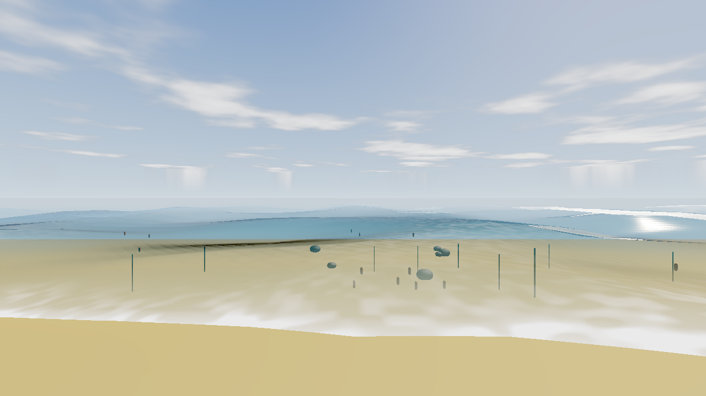
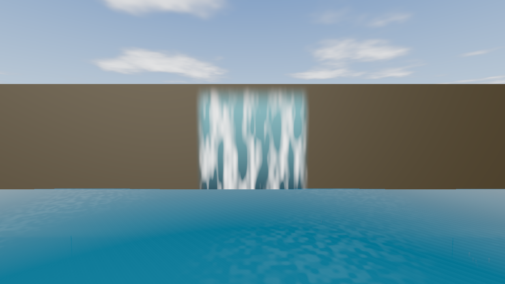
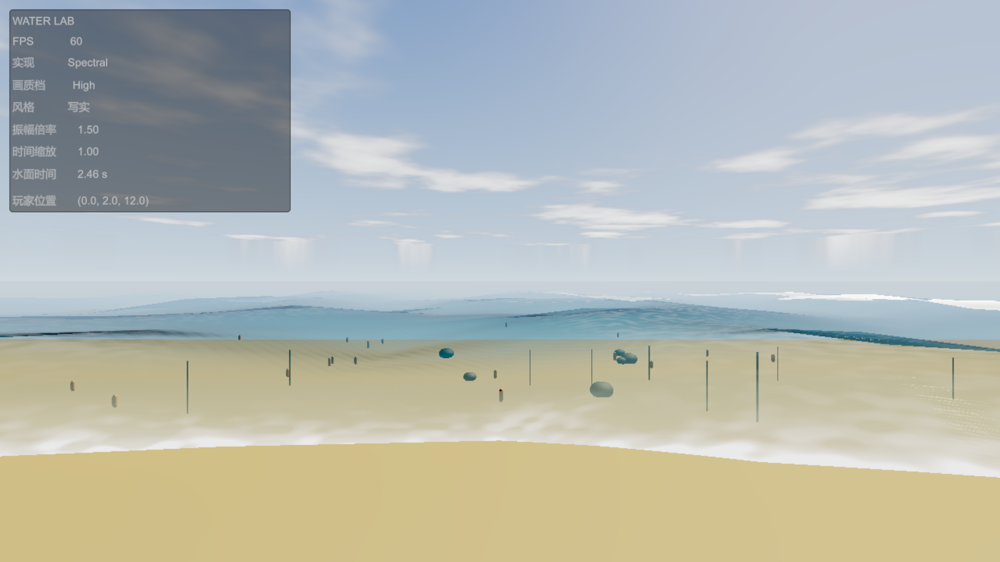

# P1 水体打磨记录

**日期**：2026-11-19  
**分支**：`p1-water-polish`（从 `main` 开，P0 已合并）  
**原则**：按你拍板的顺序：水线锯齿 → 瀑布崖壁 → Player 验证 → 全场景平面反射。  
**状态**：前 3 项完成；第 4 项平面反射做到“反射相机/RT 能出图”，但水面采样未闭环，已回滚，避免把不稳定代码留在分支。

---

## 1. 已完成

### 1.1 水线/海平线暗带

提交：`49717c6 fix(p1): soften shoreline and horizon water bands`

做了什么：

- 岸线湿沙带：浅水颜色混到 `_ShoreColor`，不再让深水色在岸边拉出暗带。
- 浅水菲涅尔衰减：`fresnel * saturate(depth/0.75)`，避免掠射角把薄水层整片染深。
- 海平线淡出：`_HorizonFadeStart=30`、`_HorizonFadeRange=120`，远处颜色/alpha 淡入海平线色。
- 水线 alpha 按 `depth/0.5` 衰减，泡沫保留。
- 新增 `WaterSurfaceRenderer.horizonColor / horizonFadeStart / horizonFadeRange / shoreColor`。

效果：



相比 P0：

- 海平线硬边基本消失。
- 岸线暗带明显变窄、变浅。
- 仍有一条很细的暗线（尤其低机位），需要后续用真实深度/AA 或更精细的岸线混合继续修；不是“完全消失”。

### 1.2 Waterfall 崖壁

提交：`cf19ef2 feat(p1): add Waterfall cliff wall behind the vertical sheet`

做了什么：

- `ScenePresets.BuildWaterfallSheet` 新增 `WaterfallCliff`：一块 120×22 的竖直 Quad，深灰岩石材质，放在坡面海侧。
- 瀑布 sheet 放在崖壁前 0.2m，避免埋进地形。
- 新增材质 `Mat_WaterfallCliff`。

效果：



现状：

- 不再“看穿坡面”，瀑布有明确崖壁背景。
- 崖壁仍是平面 Quad，没有岩石细节/凹凸；P2 可换岩壁 mesh 或加 triplanar 岩石材质。

### 1.3 Player 构建 + 运行验证

构建：

```text
BuildResult.Succeeded
size = 102,888,482 bytes
errors = 0
warnings = 5（都是 Unity 过时 API 警告）
```

运行：

- Windows Player 正常启动；
- WaterLab 水面/天空/道具/后处理可见；
- HUD 显示 60 FPS（1920×1080 窗口，Vsync 限制，仅作“能跑”证据，不是性能基准）。



---

## 2. 未完成：全场景平面反射

### 2.1 已做到哪一步

在 `p1-water-polish` 上临时实现过：

- 镜像相机（`CameraType.Reflection`，隐藏 GameObject）；
- 反射 RT（全分辨率 HDR）；
- 斜裁剪投影（`CalculateObliqueMatrix`）；
- 反射相机渲染不透明 + 天空；
- 水面 shader 增加 `_FenglingReflectionTex` / `_FenglingReflectionVP` / `_FenglingReflectionEnabled` 采样。

调试结果：

- **反射 RT 能出图**：把 RT 直接 blit 到屏幕，可以看到镜像的红方块、天空和地形；
- **水面采样没闭环**：水面里看不到红方块倒影，说明 RT → 水面的绑定/UV 仍有问题，不是反射相机完全没渲染。

### 2.2 为什么回滚

- 当前分支要保持“可运行、可构建、可回滚”；
- 反射实验代码没有达到可见效果，留在分支会污染后续 P1；
- 已用 `git checkout` 回滚 `FenglingPipeline.cs`、`FenglingWater.shader`、`WaterModule.cs` 的反射实验，删除临时 `P1ReflectTest.cs`；
- 分支仍保持 `49717c6` + `cf19ef2` 的稳定状态。

### 2.3 下一步建议

按优先级：

1. **先修反射 RT → 水面的绑定/UV**  
   - 在 shader 里输出 `_FenglingReflectionEnabled` 的调试色，确认全局 uniform 真的到达水面；
   - 用 `CommandBuffer.SetGlobalTexture` 后立刻 blit 一次 RT 到屏幕，确认不是 RT 生命周期问题；
   - 检查 `i.screenPos` 与反射相机投影的 y 翻转；
   - 检查反射相机斜裁剪矩阵是否让 RT 内容与主相机屏幕坐标不一致。
2. **如果全局纹理仍不稳**：改成 `WaterSurfaceRenderer` 材质属性，由 C# 直接把 RT/矩阵塞进材质，绕开全局 sampler。
3. **如果需要快速可用**：先接 Reflection Probe（静态天空/远岸），平面反射作为 P2；但这不是你拍板的“全场景”，只能作为兜底。
4. **验收标准**：在 WaterLab 放一个水面以上的红方块，水面里能看到红色倒影；移动相机时倒影不抖、不闪；关掉反射 FPS 明显上升。

---

## 3. 当前已知问题

| 问题 | 状态 | 下一步 |
|---|---|---|
| 低机位水线仍有一条细暗线 | 已大幅改善，未完全消除 | 真实深度/AA 或更精细岸线混合 |
| Waterfall 崖壁是平面 Quad | 可用，但缺细节 | P2 岩壁 mesh / triplanar |
| 全场景平面反射 | 反射 RT 能出图，水面采样未闭环，已回滚 | 先修绑定/UV，再重做 |
| 反射仍是 SH 兜底 | 当前稳定版水面仍用天空 SH | 平面反射修好后替换 |
| 无 TAA/AA | 远处水线仍可能锯齿 | P2 后处理/AA |

---

## 4. 提交记录

| 提交 | 内容 |
|---|---|
| `49717c6` | 水线/海平线暗带改善 |
| `cf19ef2` | Waterfall 崖壁 |
| 本文档 + `p1_player.png` | Player 构建/运行验证记录 |

> 平面反射实验未提交；相关代码已回滚。下一步从“反射 RT 绑定/UV”继续，不重写已经验证过的镜像相机/RT 部分。
