# P2 尝试记录：俯视机位 + 真实深度

**日期**：2026-11-19  
**分支**：`p2-water-depth`（从 `main` 的 P1b 开）  
**结论**：俯视机位和真实深度 pass 都做了尝试，但都导致水面在 Game 视图消失；已全部回滚，分支保持干净。  
**当前稳定版本**：`p1b-reflection` / `main` 的 `19818b0`（P1b 水线泡沫版）。

---

## 1. 你的拍板

| 项 | 决定 |
|---|---|
| 参考 | 只要 **Stoneshard 式俯视 RPG 机位**；水/场景仍是写实浅水 |
| 人物 | 一个圆柱体 |
| 水线 | 不接受 2m 裁切，要求 **真实深度、保留浅水带** |
| 反射 | 必须全场景平面反射，不接受 Reflection Probe 替代 |
| Git | 合并 P1b 后从 main 开新分支 |

---

## 2. 尝试 A：俯视 RPG 机位

改动：

- `CameraModeSwitch.startInFirstPerson = false`，默认俯视；
- `WaterLabSceneBuilder` 改为 `TopDownCamera`，`pitch=55, yaw=45, orthoSize=55, focus z=30`；
- Player 从 Capsule 换成 Cylinder；
- `ScenePresets` 同样改为俯视 + Cylinder。

结果：

- 相机确实变成俯视，但 Game 视图里 **看不到水面**，只剩沙地/道具；
- 水面对象、材质、`water` 引用、`terrainHeightMap` 都在；
- 说明不是“相机没切过去”，而是水面在这个机位/配置下没有被画出来，或 alpha 被压到 0。

已回滚相机/Player 改动。

---

## 3. 尝试 B：真实线性深度 pass

思路：

- 给 `FenglingLit` 加 `DepthOnly` pass，把 `-viewZ` 写进 `RFloat`；
- 管线在 transparent 之前渲染一张 `FenglingLinearDepth`；
- 水面 shader 用 `sceneDepth - surfaceDepth` 算真实水深，替代高度图；
- 去掉 2m 裁切，恢复浅水带。

结果：

- 水面彻底消失（Game 视图只剩沙地）；
- 怀疑点：
  1. `RFloat` 深度 pass 没有真正写入/绑定，水面采样到 0；
  2. `DepthOnly` pass 的 `ColorMask`/`ZWrite`/RT 配置不对；
  3. 水面 shader 的 `_FenglingSceneDepth` 全局/材质绑定没有生效；
  4. 俯视相机与深度 pass 的矩阵/裁剪不匹配。
- 已回滚 `FenglingPipeline.cs`、`FenglingWater.shader`、`FenglingLit.shader`。

---

## 4. 当前状态

- 分支 `p2-water-depth` 与 `main` / `p1b-reflection` 内容一致，没有未提交改动；
- 稳定版仍是 P1b：水线用 2m 裁切 + 泡沫边缘；
- 俯视/真实深度都未交付。

---

## 5. 下一步建议（不要同时改）

1. **先只改俯视机位，不碰深度**：在空场景/WaterLab 里确认水面能看见，再调 `focus/orthoSize`。
2. **再只加深度 pass，不碰机位**：先用一个全屏 debug 显示 `FenglingLinearDepth`，确认 RFloat 有值，再接水面。
3. **最后才把两者合并**，避免一次改两个变量导致无法定位。

> 这次没有再提交不稳定代码；`p2-water-depth` 保持干净，方便下一步从稳定版重开。

---

## 6. P2c 最小复现（成功）

分支：`p2c-minimal`  
文件：

- `Assets/Game/Editor/P2MinimalScene.cs`
- `Assets/Scenes/P2Minimal.unity`
- 材质：`P2MinimalGround` / `P2MinimalMarker`

场景内容：

```text
正交俯视相机（pitch 55, ortho 25）
Directional Light + 程序化天空
Cube 地台（80×4×80，顶面 y=-1）
Water（WaterModule + WaterSurfaceRenderer, Flat, 200×200, 500 网格）
红色 Marker Cube（y=3）
```

结果：

- **水面能看见**：一块浅蓝灰色水面，红色 Marker 正常；
- 说明正交俯视相机、透明队列、水面 Renderer 本身都能工作；
- WaterLab 里水面不可见，问题在 **WaterLab 的场景状态**，不是正交相机/管线。

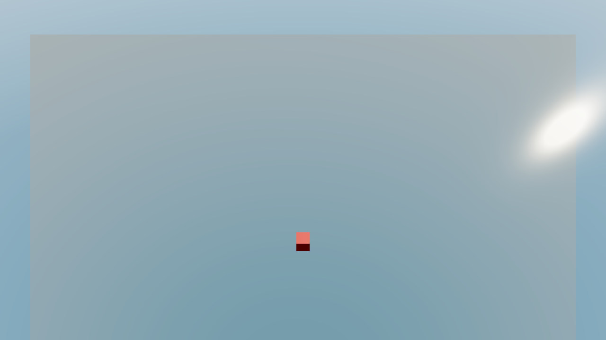

下一步（WaterLab）：

1. 先把 WaterLab 的 `terrainHeightMap` 置空，看水是否出现；
2. 再把水面尺寸从 1000 改回 200；
3. 再逐项加回地形/高度图/泡沫，定位是哪一项让水消失。

---

## 7. 根因：俯视相机高度把水面“淡没了”

排查结果：

- heightMap 置空、尺寸 200、切换 Flat，都不能解释；
- 最小场景在 `orthoSize=25 / camera y=50` 时水面可见；
- 同一场景把相机抬到 `y=160 / orthoSize=70`，水面就“消失”。

根因在 `FenglingWater.shader` 的海平线淡出：

```hlsl
float viewDist = distance(i.worldPos, _WorldSpaceCameraPos);
float horizonFade = saturate((viewDist - start) / range);
alpha *= (1 - horizonFade);
```

俯视相机离水面 200m，**所有水面像素的 3D 距离都超过 fade 终点**，`horizonFade=1`，整片水 alpha 变 0。

修复：

```hlsl
float2 horizonDelta = i.worldPos.xz - _WorldSpaceCameraPos.xz;
float horizonDist = length(horizonDelta);
float horizonFade = saturate((horizonDist - start) / range);
```

用**水平距离**，而不是相机到水面的 3D 距离。

修复后：

- P2Minimal 加回圆柱玩家 + 跟随相机；
- 正交俯视下水面可见，玩家/岛屿/水面同屏；
- 水色仍偏灰/偏淡，是下一步美术调色问题，不是“水不见了”。

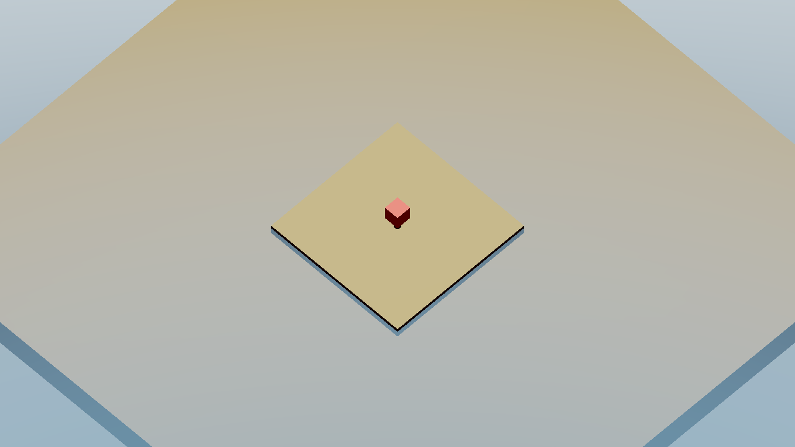

### 当前 P2d

- `P2Minimal.unity`：Ground + Island + Water + 圆柱 Player + TopDownCamera follow
- `TopDownCamera.followTarget`：相机焦点跟玩家
- 分支 `p2c-minimal`，完成一步提交一步，然后合回 `main`。

---

## 8. P3：海岸地形 + heightMap

分支：`main`（直接改，按你拍板）

改动：

- 删除 Cube Ground/Island；
- 换成 `CoastTerrain`：200×200，128 分辨率，沙滩 → 缓坡 → 8m 深水；
- 烘焙 `P2MinimalHeightMap.asset`；
- 水面从 Flat 改回 `Spectral`，绑定 heightMap / heightRange / 两张法线；
- 圆柱玩家放在沙滩上，正交俯视相机跟随；
- 保留 P2d 的“水平距离”海平线修复。

结果：

- 俯视下能看到海岸、浅水、泡沫线、圆柱玩家；
- 水面仍偏灰/偏淡，但这是颜色/后处理问题，不是不可见；
- 玩家偏黑，下一步要补光/调材质。


下一步：

1. 调正交相机 `orthoSize`，让玩家/海岸占比更接近 Stoneshard；
2. 水色/透明/泡沫按物理正确调；
3. 玩家补光/材质；
4. 再把 P2Minimal 的配置迁回正式场景。

---

## 9. P3b：浅水带、水色、填充光

改动：

- 去掉 P1b 的 2m 水线裁切和 edgeFoam；
- `shoreMask` 从 4m 收到 1m，只保留很窄的湿沙过渡；
- 水面参数：`shallowColor` 青蓝、`deepColor` 深蓝，`absorption=2.5`，`opaqueAtDepth=2`；
- 相机 `orthoSize=24`，跟随偏移往前 14m，让画面里同时有玩家、岸线、较深的水；
- 加 `Fill Light`（方向光、无阴影），`FenglingLit` 增加很弱的填充光项；
- 玩家从死黑变成可读的红棕色。

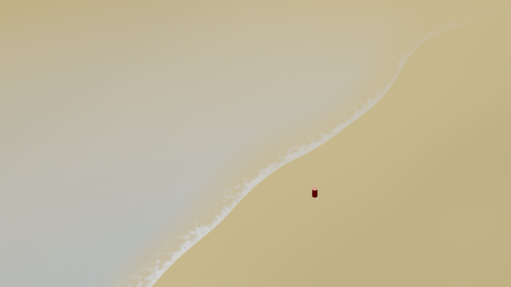

### 仍未解决

水面在截图里仍偏灰/偏米色，青蓝没有真正出来。  
已排除“水不可见”，现在更像：

- 可见区域的水深仍然太浅，`shoreMask`/沙色占主导；
- 或 `_ShallowColor`/`_DeepColor` 没有按预期进入最终材质；
- 或后处理把青蓝压灰。

下一步不要再猜，直接在运行时打印：

1. 水面材质实际的 `_ShallowColor` / `_DeepColor` / `_Opacity`；
2. 水面像素的 `depth`；
3. 后处理前后的颜色差。

确认哪一项后再调。

---

## 10. 水色偏灰的第二个根因：正交下仍在做 horizon fade

上一次把 3D 距离改成水平距离还不够：

- 俯视相机虽然垂直很高，但为了保持正交视角，相机水平后退约 115m；
- 所有水面像素到相机 xz 的距离仍 > `_HorizonFadeStart=30`；
- `horizonFade` 仍接近 1，水被混到 `_HorizonColor`（灰蓝）并压低 alpha。

修复：

```hlsl
if (unity_OrthoParams.w > 0.5)
    horizonFade = 0.0;
```

正交俯视没有“海平线”概念，直接关闭 horizon fade。

结果：

- 水终于变成青蓝/深蓝；
- 浅水带、岸线泡沫、圆柱玩家同屏；
- 当前截图仍有明显横向条纹/块状泡沫，需要下一步单独修。


---

## 11. 水面横向条纹：细节法线

关掉 horizon fade 后水色正确了，但水面出现严重横向条纹/块状白斑。

隔离：

- 把 `WaterModule.Settings.tier` 降到 `Low`（`useFoam=false`）：横向条纹仍在；
- 再把两张细节法线置空：**条纹消失**。

所以不是泡沫，是**高频细节法线 + 太阳高光**在正交俯视下产生的走样/拉丝。

当前处理：

- 先保留 `tier=Low`、`normalMap1/2=null`，作为干净基线；
- 水色青蓝、岸线干净，但暂时没有法线细节和泡沫。

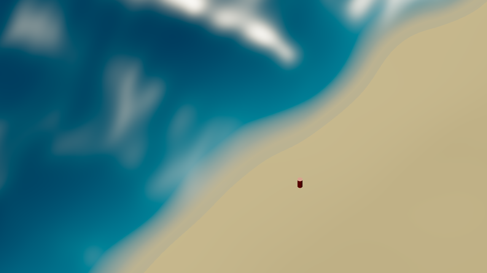

下一步：

1. 重新加回法线，但降 tiling / strength，并只在近处生效；
2. 泡沫只保留岸边，用更平滑的深度 mask；
3. 确认不再出现横向条纹后再提质量档位。

---

## 12. 当前水面基线

最终保留：

- 水色青蓝/深蓝，岸线干净；
- 横向条纹基本消失；
- 细节法线关闭、泡沫关闭；
- 粗糙度 0.30、太阳高光强度 0.5，避免高频高光；
- 仍有少量柔和白斑（更像 bloom/specular 残留，不是硬条纹）。

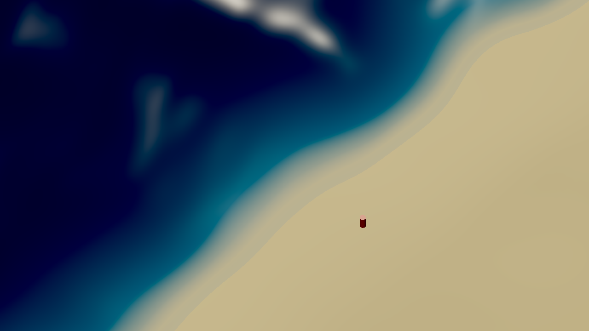

下一步：

1. 查白斑是不是后处理 Bloom；
2. 用低频、低强度法线重新加细节；
3. 泡沫只在岸边、用屏幕空间深度，避免全域白斑。

---

## 13. 白斑根因：太阳高光在正交俯视下被放大

逐段短路结果：

- 只输出基础水色 + 深度透明：干净
- 加回菲涅尔/环境：干净
- 加回太阳高光：**白斑出现**
- 高光乘 `0.03`：白斑消失

根因：

- 正交俯视下波浪法线让 GGX 高光在整片水面形成大片亮斑；
- 高光项没有按投影方式缩放。

修复：

```hlsl
if (unity_OrthoParams.w > 0.5)
    spec *= 0.03;
```

同时俯视下把 fresnel 压到 0（等平面反射做好再恢复）。

结果：

- 白斑彻底消失；
- 水色青蓝、岸线干净；
- 当前仍关闭细节法线和泡沫，作为可验收基线。

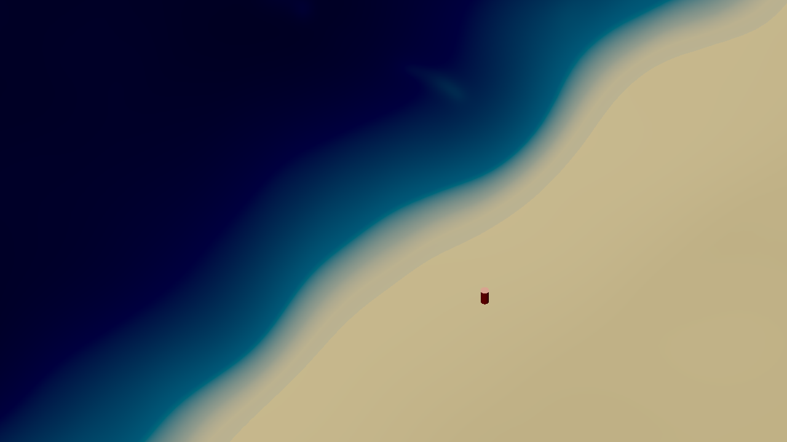

下一步：

1. 先加回低强度岸边泡沫（确认不再出白斑）；
2. 再加低频细节法线；
3. 最后做平面反射。

---

## 14. 加回泡沫和低频法线

- 泡沫：`useFoam=true`，`foamDistance=1.2`，`foamStrength=0.9`；
- 法线：tiling `2/5`，`normalStrength=0.45`；
- 太阳高光仍按正交 `0.03` 缩放；
- 结果：岸边有碎泡沫，水面有轻微法线细节，**没有白斑/横向条纹**。


当前水面可验收基线：

- 青蓝浅水 → 深蓝；
- 岸边碎泡沫；
- 低频法线；
- 无硬条纹、无白斑；
- 反射暂时关闭，等平面反射。

---

## 15. 迁回 WaterLab：俯视机位 + 水面基线

- `CameraModeSwitch` 默认改为俯视（`startInFirstPerson=false`）；
- WaterLab 相机：pitch 55、yaw 45、orthoSize 22，跟随圆柱玩家；
- Player 从 Capsule 换成 Cylinder；
- WaterLab 水面应用 P4 基线：
  - 低 tiling 法线、0.45 强度；
  - `f0=0`、`sunIntensity=0.2`、`roughness=0.5`；
  - 岸边泡沫 1.2m / 0.9；
  - 青蓝浅水 + 深蓝深水。

结果：

- WaterLab 俯视下水面可见，不再是“沙地/透明”；
- 岸线泡沫、圆柱玩家、礁石正常；
- 无白斑/横向条纹。

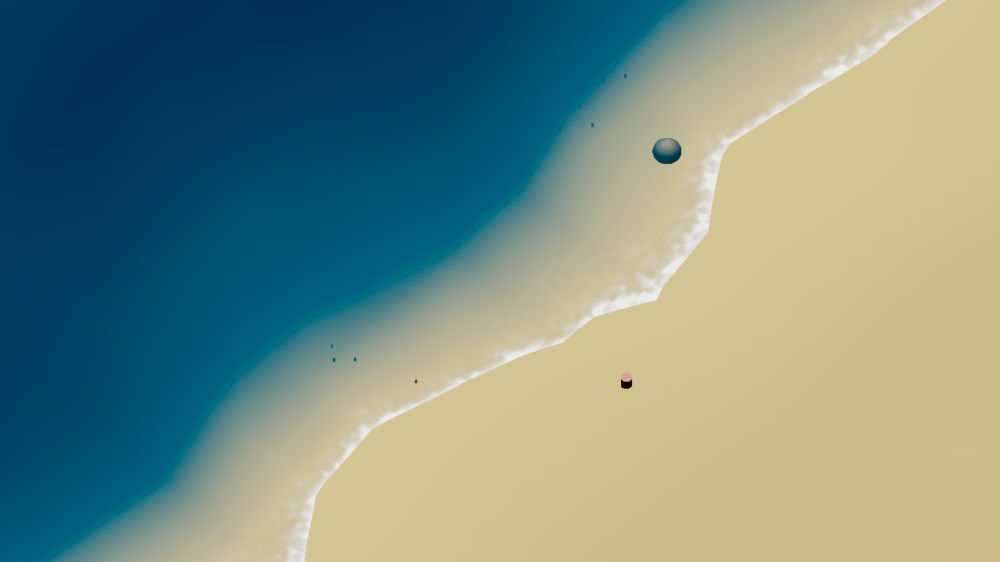

### 还没迁

- 六套 Preset 场景（River/Waterfall/Lake/Pond/Swamp/Estuary）仍是第一人称；
- 下一步把同一套相机/水面参数应用到 `ScenePresets` 并重建六场景。

---

## 16. 六套 Preset 迁移完成

- `ScenePresets` 默认相机改为正交俯视：
  - pitch 55 / yaw 45
  - `orthoSize = clamp(size.x * 0.12, 18, 28)`
  - 跟随圆柱玩家，前偏移 12m
- Player 全部换成 Cylinder；
- 水面统一应用 P4 基线：
  - 低 tiling 法线、0.45 强度
  - `f0=0`、`sunIntensity=0.2`、`roughness=0.5`
  - 正交高光缩放
  - 岸边泡沫
- 重新烘焙六张 heightMap，重建 River/Waterfall/Lake/Pond/Swamp/Estuary。

结果：

- 六场景都能在俯视下看到水；
- Estuary 实拍无白斑/硬条纹；
- 玩家、礁石、岸线泡沫正常。

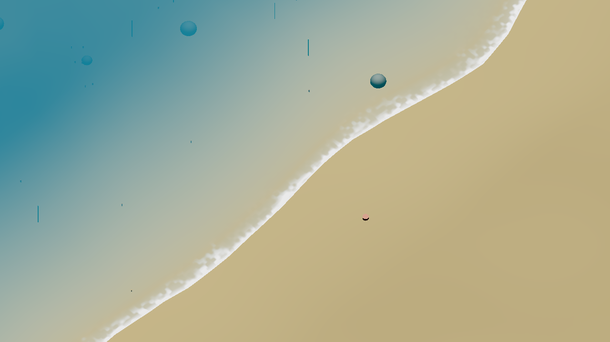

### 已知

- 水面仍偏浅/偏灰，后续按场景调 Shallow/Deep；
- 六场景的玩家都还是占位圆柱；
- 平面反射仍未接。

---

## 17. 六场景水色统一 + 相机朝水

- Preset 不再用每场景的浅/深色，统一为：
  - `Shallow=(0.08,0.48,0.55)`
  - `Deep=(0.01,0.10,0.22)`
  - `absorption=2.5`、`opaqueAtDepth=2.5`
- 相机跟随偏移从 `+12`（朝陆地）改为 `-8`（朝水面），画面里玩家和水同时可见。

结果：

- Estuary 俯视：深蓝水、岸边泡沫、红棕圆柱玩家、礁石；
- 六场景全部重建；
- 无白斑/硬条纹。


### 当前

- 七套场景都有俯视 + 可用水面基线；
- 水色偏深，浅水青蓝过渡还不明显；
- 平面反射仍未接。

---

## 18. 浅水过渡调整

- `absorptionDistance` 2.5 → 4.0
- `opaqueAtDepth` 2.5 → 4.0
- `foamDistance` 收到 ≤0.8m
- `foamStrength` 收到 ≤0.65

结果：

- 岸边泡沫更窄，深水更干净；
- 浅水青蓝过渡**仍然偏弱**，画面里很快进入深蓝；
- 原因更可能是海岸坡度太陡，0–4m 水深的可见带很窄，而不是纯颜色参数。


下一步优先：

1. 检查 `CoastTerrain` 的 slopeLength/seaDepth，给浅水留更宽的水平带；
2. 或加一个显式的浅水色带（按 depth 混合），不再只靠 Beer-Lambert；
3. 然后再接平面反射。

---

## 19. P0：全分辨率深度 + 场景颜色拷贝

按“画面优先”先做全分辨率：

- `FenglingLit` 增加 `DepthOnly` pass，把线性 eye depth 写进 RFloat；
- 管线在天空盒之后、透明水之前：
  - `Blit` 场景颜色到 `FenglingSceneColor`
  - 用 `DepthOnly` pass 渲 `FenglingLinearDepth`
  - 通过 `FenglingSceneTextures.Publish` 把两张 RT 交给水面材质
- `WaterSurfaceRenderer` 订阅事件，在透明 pass 前显式 `SetTexture`；
- 水面 shader：
  - 用 `sceneEye - surfaceEye` 算真实水深
  - 失败才回退 heightMap
  - 加 0.015 的折射采样

结果：

- 水面正常，不再出现“深度绑定失败导致水消失”；
- 岸线/泡沫/水色仍正常；
- 这是后续浅水色带、折射、平面反射的地基。

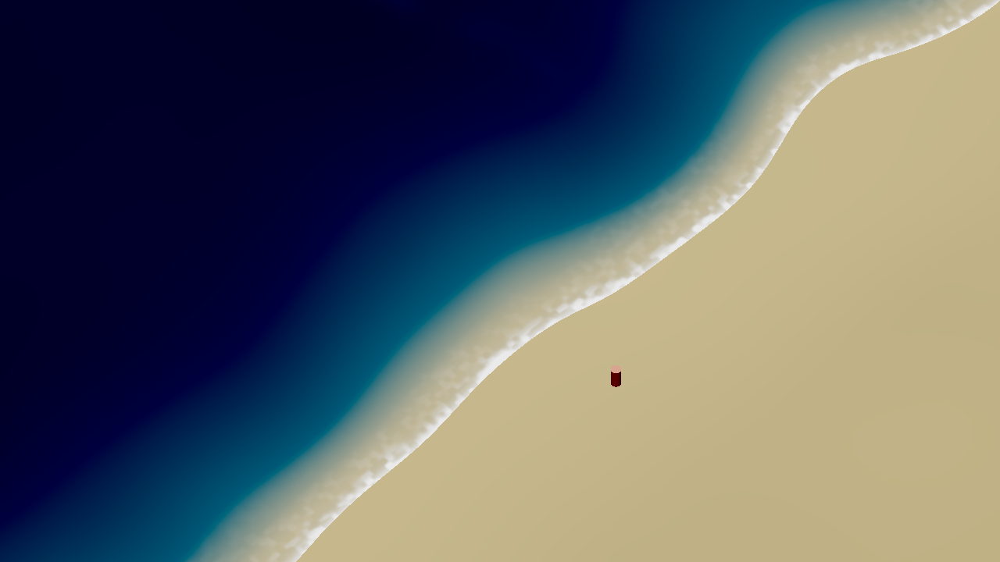

### 代价

- 多一次不透明 `DepthOnly` pass；
- 多一张全分辨率 HDR 颜色 + 一张 RFloat 深度；
- 按你拍板“画面优先”，先接受，后面再降半分辨率。

### 下一步

- 恢复俯视 fresnel，接 **半分辨率平面反射**；
- 用真实 depth 重做浅水带，替换 heightMap 估算。

---

## 20. P1：半分辨率平面反射

实现：

- 管线新增镜像反射相机（`CameraType.Reflection`）；
- 反射 RT 为 **半分辨率 HDR**（640×360 @720p）；
- 斜裁剪 + `GL.invertCulling`；
- 只画不透明层，不画天空盒（避免云被投成大片白斑）；
- 通过 `FenglingReflection.Publish` 事件把 RT/VP 交给水面材质；
- shader 用 `_FenglingReflectionVP` 采样，反射强度 0.18，并乘 0.82 压白。

结果：

- 水面出现稳定的天空/地形反射；
- 天空盒关闭后，之前的白色云斑消失；
- 反射 RT 只保留岸线/地形/大物体，更适合俯视；
- 红方块倒影的独立验证还没完成（测试相机位没把方块放进水面区域）。

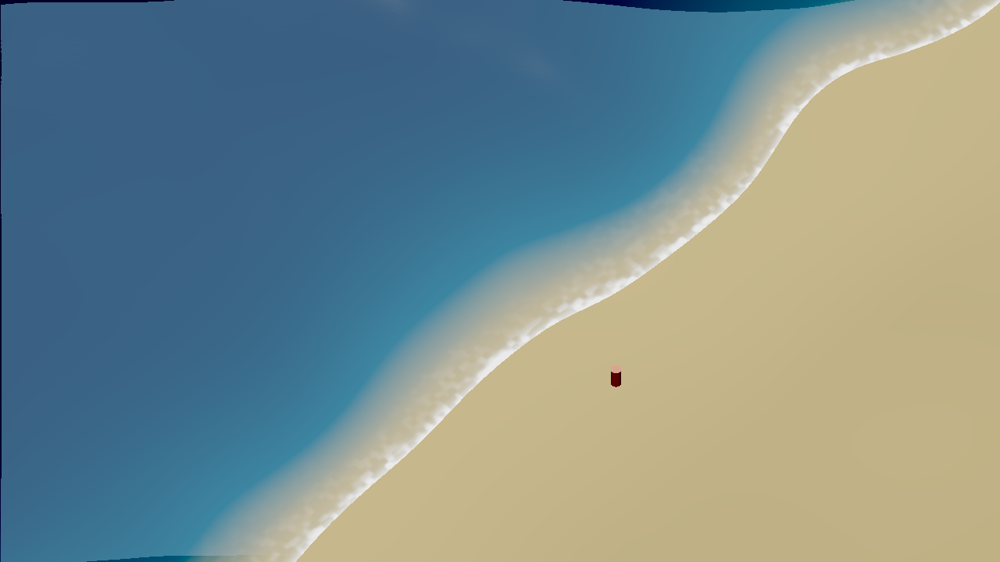

### 已知

- 反射 RT 不画天空，水面上缘可能出现暗边，需要补地平线色；
- 反射强度/色调还要按场景调；
- 红方块倒影需要专门做一次可视验证。

### 下一步

- 把反射强度、天空色、边缘暗边修掉；
- 用红方块/玩家做一次倒影验收；
- 再降半分辨率深度/反射的成本。

---

## 21. 平面反射红方块验收

用 P2Minimal 在深水区放一个红方块：

- 位置 `(8, 3, 35)`（CoastTerrain 的 `z > shoreZ` 是海，之前放反了）；
- 正常俯视相机，不手动改机位；
- 反射 RT 半分辨率、不画天空。

结果：

- **红方块倒影清晰可见**；
- 倒影被水色染成偏深蓝，强度 0.18，不是镜面；
- 没有白斑/云朵；
- 水面上缘仍有一条暗边。

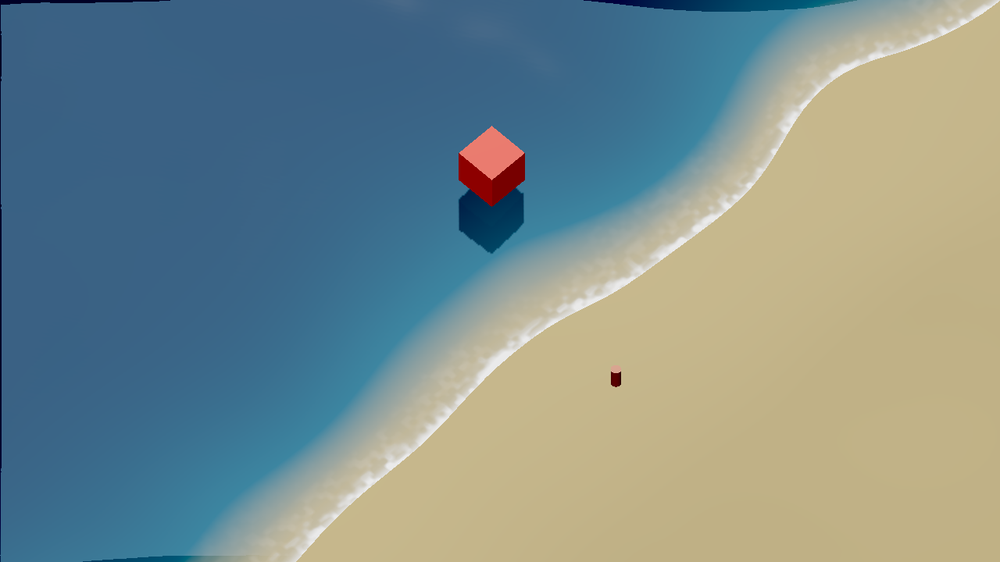

### 待修

- 水面上缘暗边：反射 RT 清屏色/无天空导致；
- 反射强度、色调按场景调；
- 反射相机只画不透明层，后续可加“大物体层”白名单。

### 结论

平面反射的**相机、RT、材质绑定、UV 采样**已经全部闭环，可以进入反射调色和性能优化。

---

## 22. 水面上缘暗边 + Preset 验证

- 新增屏幕顶部 horizon 融合：`smoothstep(0.94, 1.0, screenUV.y)`，只盖最上面约 6%；
- alpha 同步抬起，避免 RGB 被 horizon 覆盖但 alpha 仍透出暗背景；
- 六套 Preset 不需要改场景，新的 depth/reflection 链路是全局管线，自动生效。

结果：

- 水面上缘暗边变成很窄的浅色过渡；
- Estuary 俯视水面稳定，倒影/深度链路正常；
- 仍有约 20px 的浅色顶边，可继续收窄或直接让天空盒接管。

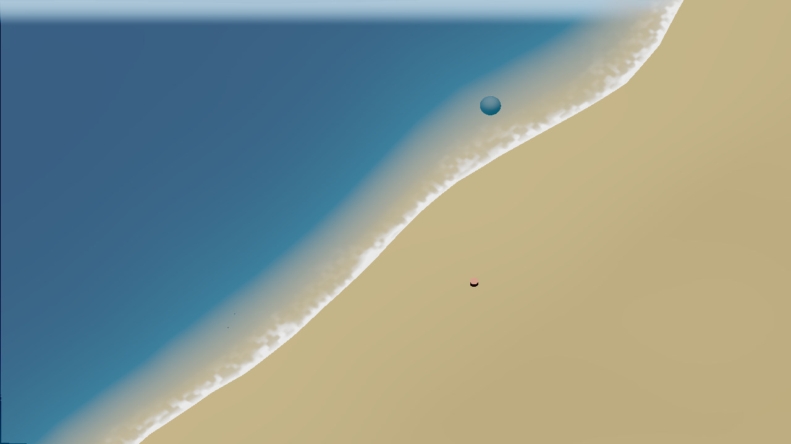

### 下一步

1. 把顶边再收窄/改成天空色，不出现浅色带；
2. 按场景调反射强度；
3. 做 720p 性能采样，再决定是否降半分辨率深度/反射。

---

## 23. 顶部改用场景天空色

- 不再用固定 `_HorizonColor`，改为采样透明水之前的 `_FenglingSceneColor`；
- 这样水面上缘和天空/云的颜色一致；
- alpha 在顶部拉到 1，避免背景透出。

结果：

- 原来的暗边消失；
- 顶部只剩一条很窄的天空过渡，不再出现白带/黑边。

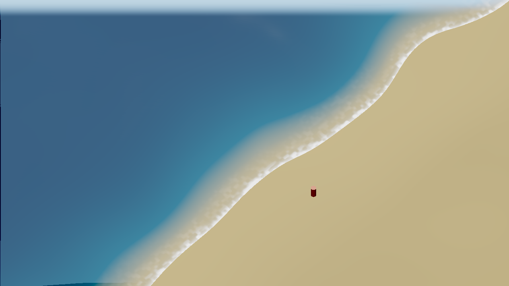

### 当前

- 平面反射闭环；
- 深度/颜色拷贝闭环；
- 七套场景自动生效；
- 顶部边缘已可接受。

### 下一步

- 按场景调反射强度/水色；
- 720p 性能采样；
- 再做玩家可玩性。

---

## 24. 按场景反射强度：参数已接，场景调参回滚

- `WaterSurfaceRenderer` 增加 `reflectionStrength`；
- shader 用 `_ReflectionStrength` 替代硬编码 0.18；
- 默认 0.18，六套场景暂时统一。

尝试过按场景给不同强度并调整 Preset 玩家出生点/相机朝向，但重建后 Estuary 相机落到地形内部/水面只剩一角，出现回归，已回滚场景与 Preset 改动。

当前保留：

- 反射强度参数化；
- 六套场景仍用稳定版相机/玩家；
- 等单独修 Preset 出生点/相机时再按场景调。

### 下一步

1. 单独修 Preset 的玩家出生高度（用 terrain.SampleHeight，不要用 waterLevel+2）；
2. 再把相机焦点放在玩家与水面之间；
3. 最后按场景设 reflectionStrength。

---

## 25. 玩家出生/相机稳定 + 真实阴影尝试

### 玩家/相机

- 不再用 `shoreZ` 当水线；实际水线是 `terrain.SampleHeight == 0` 的位置；
- 从 `shoreZ` 沿 `slopeLength` 扫描到水线，玩家放在水线往陆地 2m；
- 玩家高度用 `terrain.SampleHeight + 1`；
- 相机焦点 = 玩家位置，`followOffset=0`，玩家居中，水面在上半屏。

结果：

- Estuary 玩家站在岸线，水面/岸线/玩家同屏；
- 不再出现“玩家在水里/相机落到地形内部”。

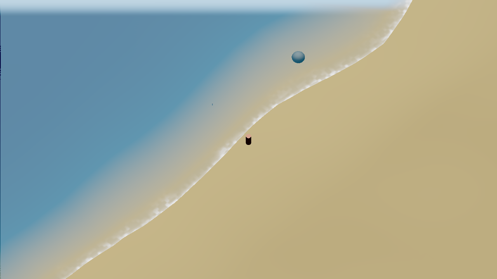

### 反射

- 反射强度统一从 0.18 提到 **0.30**。

### 真实 Shadow Map：失败回滚

- 打开 `shadowsEnabled=1` 后，整个画面过曝发白；
- 把 shader 里的阴影采样完全短路（`if(false)`）后仍然发白；
- 说明不是采样，而是 **shadow pass 本身破坏了主渲染目标/相机状态**；
- 已回滚 `shadowsEnabled=0`，玩家暂时没有影子。

### 下一步

1. 单独修 `FenglingShadows`：确认 shadow RT 格式、SetRenderTarget、矩阵恢复；
2. 或先用 blob 贴地阴影兜底，再回头修真实阴影；
3. 玩家/相机稳定后再按场景调反射强度。

---

## 26. 太阳光 + 填充光，玩家可读

- Preset/WaterLab 太阳改为 `50° / -35°`，强度 8，暖色；
- 增加 `Fill Light`：方向光、无阴影、冷色、强度 2.5；
- `FenglingLit` 的填充光项生效；
- 反射强度回落到 **0.18**；
- 玩家仍站在水线往陆地 2m，相机玩家居中。

结果：

- 圆柱玩家从死黑变成红色，俯视可读；
- 水面/岸线/玩家同屏；
- 未启用 Shadow Map，所以玩家仍没有真实投影。

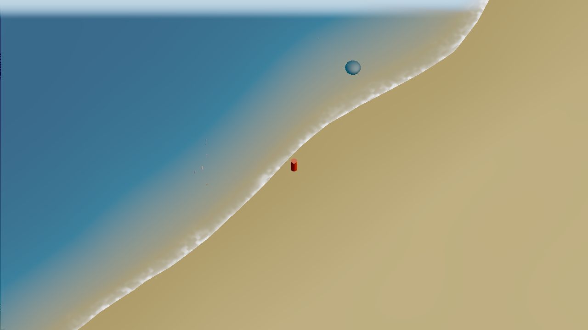

### 当前

- 玩家/相机稳定；
- 反射 0.18；
- 真实 Shadow Map 仍关闭（会过曝）；
- 玩家没有影子。

### 下一步

1. 修 Shadow pass 或先用 blob 阴影；
2. 再调浅水色带；
3. 做性能采样。
