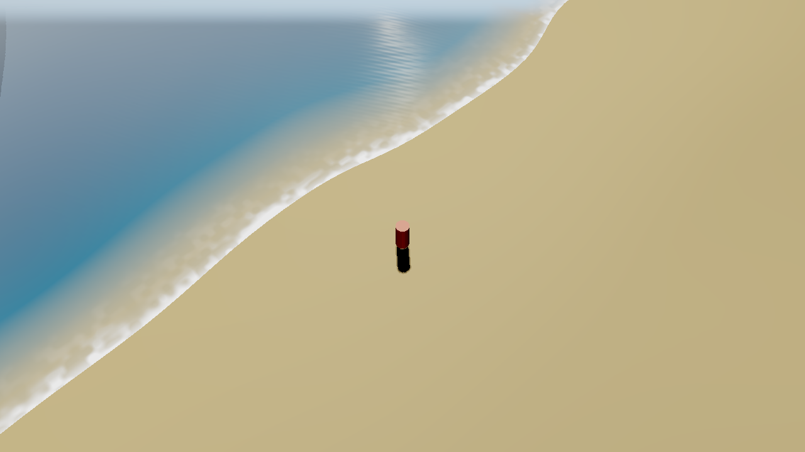
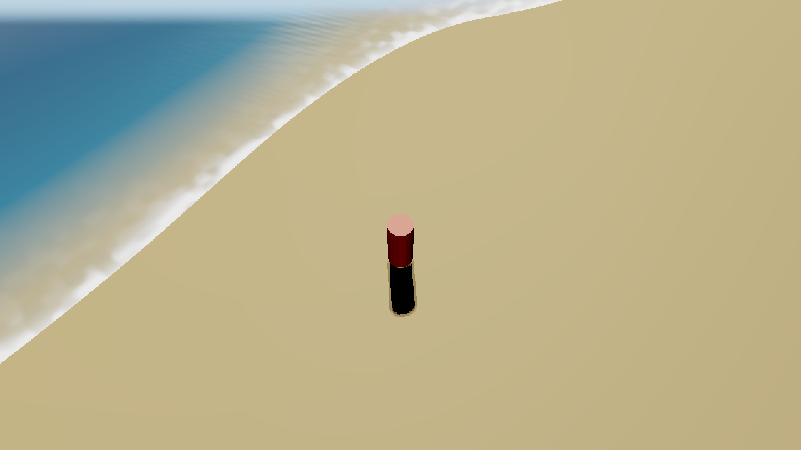
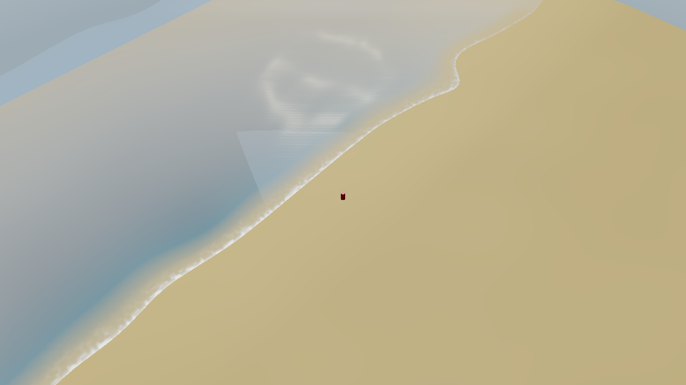
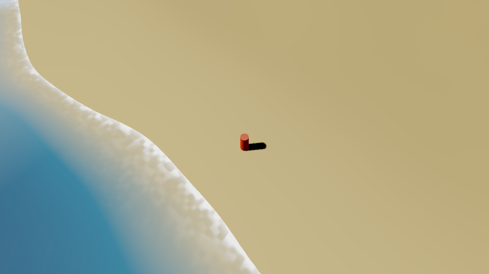

# Phase 1：RPG RTS 相机执行文档

**日期**：2026-11-20  
**目标**：Manor Lords 式透视自由 RTS 相机，先独立跑通，不接太阳/阴影/水面时间系统。  
**基线**：`main` / `98fc03d`（相机改造前）  
**原则**：学习成熟方案的结构，不引入不必要的包；一次只验收相机。

---

## 1. 参考案例

### Manor Lords 操作模型

- WASD 平移
- F / G 旋转
- 中键拖拽改变俯角/环绕
- 滚轮缩放
- 可选屏幕边缘平移
- 相机不是锁死玩家的第三人称，而是自由 RTS 视角

来源：[Manor Lords 相机操作讨论](https://steamcommunity.com/app/1363080/discussions/0/4362376656103754812)

### RTSCameraController-Cinemachine

可借鉴：

- 目标点 + 相机 Rig 的结构
- RTS 旋转（带俯角）
- 缩放
- WASD / 鼠标拖拽 / 屏幕边缘平移
- 锁定目标
- 缩放越大、平移越快
- 边界限制
- 平滑
- 地面高度检测

不直接采用：

- Cinemachine 依赖（当前自建 SRP，先不加包）
- 复杂 Input Provider 体系（Phase 1 用旧 Input，后续再抽象）

来源：[RTSCameraController-Cinemachine](https://github.com/Nickk888SAMP/RTSCameraController-Cinemachine)

### Stratecam

可借鉴：

- `GoTo(position)` / `Follow(target)` 两个显式 API
- 地形高度自适应
- 缩放非线性、越远移动越快
- 平滑参数
- 双击地面移动（Phase 2 再做）

不直接采用：

- JS 实现
- Unity Standard Assets 示例依赖

来源：[Stratecam](https://github.com/federicocasares/stratecam)

---

## 2. Phase 1 功能规格

### 2.1 必须做

| 功能 | 规格 |
|---|---|
| 投影 | 透视，FOV 45° |
| 平移 | WASD/方向键，相对相机 yaw |
| 缩放 | 滚轮，距离 15–120m，非线性 |
| 旋转 | 中键拖拽 + Q/E，yaw 自由 |
| 俯角 | 35°–75°，中键拖拽改变 |
| 聚焦 | Space 聚焦玩家 / 退出自由 |
| 边界 | 地形尺寸内，不飞出地图 |
| 地面 | 相机不低于地形 + 1.2m |
| 水面 | 相机不低于水面 + 1.0m |
| 平滑 | 位置 SmoothDamp，旋转 Slerp |
| 速度 | 缩放越大，平移越快 |
| 边缘滚动 | 默认关闭（保留开关） |

### 2.2 暂不做

- 屏幕边缘滚动默认开启
- 双击地面 GoTo
- 手柄/新 Input System
- Cinemachine
- 相机遮挡物淡出
- 时间/太阳/阴影/水面联动

---

## 3. 架构

```text
RpgLab
├─ Main Camera
│  └─ RtsCameraController
│     ├─ 输入：WASD / 滚轮 / 中键 / QE / Space
│     ├─ 目标点 focus
│     ├─ 边界 clamp
│     ├─ 地面/水面 clearance
│     └─ 平滑输出 position/rotation
├─ Player（聚焦目标）
├─ CoastTerrain（SampleHeight）
└─ Water（水面高度 global）
```

### 文件

- `Assets/Game/Player/RtsCameraController.cs`
- `Assets/Game/Editor/RpgLabScene.cs`
- `Assets/Scenes/RpgLab.unity`
- `Fengling.Player.asmdef` 增加 `Fengling.Environment` 引用

---

## 4. 实现步骤

### Step 1：Controller 骨架

- `[RequireComponent(typeof(Camera))]`
- 透视/FOV/near/far
- 字段：focusTarget、yaw、pitch、distance、bounds、clearance、smoothing

验收：编译通过，场景里相机是透视。

### Step 2：平移/缩放/旋转

- WASD/方向键，相对 yaw
- 滚轮改 distance，clamp 15–120
- Q/E 改 yaw
- 中键拖拽改 yaw/pitch
- pitch clamp 35–75
- 缩放越大平移越快

验收：手动 Play，五种输入都有效。

### Step 3：边界/地面/水面

- focus.x/z clamp 到地形 bounds
- 相机 y >= terrain.SampleHeight(camera.xz) + 1.2
- 相机 y >= waterLevel + 1.0
- 不穿地、不穿水

验收：拉近/压低/移到岸边不穿模。

### Step 4：聚焦玩家

- Space 切换 focused
- focused 时 focus = player.position + offset
- 手动平移自动退出 focused
- 退出后保留当前位置

验收：Space 聚焦/退出稳定，不跳变。

### Step 5：RpgLab 场景

- 从 P2Minimal 复制为 RpgLab
- 移除 TopDownCamera/FirstPersonCamera/CameraModeSwitch
- 挂 RtsCameraController
- 玩家/水面/地形保留
- 相机默认：yaw45、pitch55、distance35、聚焦玩家

验收：默认画面能看到玩家、岸线、水面。

### Step 6：截图验收

- 默认视角截图
- 近景（distance 18）
- 远景（distance 90）
- 旋转 90° 后截图
- 检查边界/地面/水面

---

## 5. 验收清单

- [ ] 相机是透视，不是正交
- [ ] WASD 平移方向随 yaw 正确
- [ ] 滚轮缩放平滑，15–120m
- [ ] 中键拖拽可旋转/改俯角
- [ ] Q/E 旋转
- [ ] pitch 不越界
- [ ] Space 聚焦玩家/退出
- [ ] 相机不穿地形、不穿水面
- [ ] 不飞出地形边界
- [ ] 缩放越大平移越快
- [ ] 默认画面玩家/岸线/水面同屏
- [ ] 没有改太阳/阴影/水面时间系统

---

## 6. 风险

1. 相机地面检测用 `SampleHeight`，不是物理碰撞；陡坡/悬崖可能仍需 Raycast。
2. 聚焦玩家时如果玩家移动，focus 跟随，可能出现轻微延迟；Phase 1 接受。
3. 中键拖拽的灵敏度需要手感调参，先给保守值。
4. 目前只改 RpgLab，六套 Preset 等相机验收后再迁。

---

## 7. 完成定义

- RpgLab 可自由平移/旋转/缩放/聚焦
- 相机不穿地/水/边界
- 默认画面可读
- 提交一次 `feat(p9): add perspective RTS camera and RpgLab`
- 不碰太阳、阴影、水面时间系统

---

## 8. 实现记录（2026-11-20）

已完成：

- `RtsCameraController`：透视 FOV45、WASD 平移、滚轮 15–120m、缩放非线性、缩放越大移动越快、中键拖拽/QE 旋转、pitch 35–75、Space 聚焦、地形/水面 clearance、边界 clamp、位置/旋转平滑。
- `RpgLab`：从 P2Minimal 复制，移除 TopDownCamera/FirstPersonCamera/CameraModeSwitch，挂 RTS 相机；玩家/水面/地形保留。
- Phase 1 只改 RpgLab，六套 Preset 未迁。

截图：









已验证：

- 透视正常，近大远小；
- 近/远/旋转三档画面正常；
- 旋转后能看到玩家影子，说明相机没有破坏阴影链路；
- 相机贴地/水面时有 clearance clamp。

已知：

- `distance=90` 远景下水面出现矩形接缝/条带，这是现有水面平面反射/网格的问题，不是相机引入；
- 六套 Preset 仍是旧 TopDownCamera，下一步再迁；
- 没有真正模拟鼠标键盘输入，只验证了相机参数与渲染结果；手感需要 Play 里手动调。
