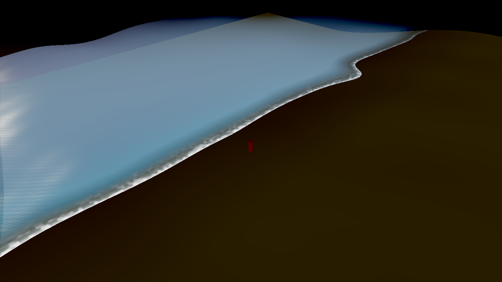

# Phase 2：昼夜核心执行记录

**日期**：2026-11-20  
**目标**：时间核心 + 太阳/月亮方向 + 天空颜色 + 环境光；不接阴影级联、不接水面联动。  
**场景**：`Assets/Scenes/RpgLab.unity`（Phase 1 相机场景）

---

## 1. 已实现

### 时间

- `TimeOfDaySystem`：
  - 0–24h、day、season
  - 连续推进
  - `gameMinutesPerSecond=1`（24 现实分钟一天）
  - 暂停 / 调速 / `SetTime` / 拖时间条
  - 调试 HUD：显示时间/Day/Season，滑块、Pause、倍速

### 太阳/月亮

- 太阳赤纬按季节/日期近似
- 太阳方位/高度由纬度 35° + 时角计算
- 方向光旋转 = 太阳方向
- 太阳强度/颜色按高度插值（低角度偏橙）
- 月亮方向与太阳相对，夜晚强度淡入

### 天空

- `FenglingSkybox` 增加：
  - `_MoonDirection` / `_MoonColor` / `_MoonSize`
  - `_NightFactor`
  - `_StarIntensity`
- 夜晚天空变暗、月亮光晕、星星
- 时间系统驱动：
  - `_ZenithColor` / `_HorizonColor`
  - 云颜色/暗部
  - 天空盒实例化，不改共享材质

### 环境光

- 时间系统改用 Flat Ambient
- `FenglingLit` 增加 `_FenglingAmbientColor` / `_FenglingAmbientScale` 全局
- 避免自建 SRP 下 Skybox SH 不随天空刷新导致夜晚仍亮

---

## 2. 验收截图

6:00：

12:00：

18:00：

0:00：

---

## 3. 已验证

- 拖时间/SetTime 后太阳方向变化；
- 玩家影子方向随时间变化（6/18 长影，12 短影）；
- 天空颜色随时间变化；
- 夜晚天空变暗；
- 24h 循环时间推进代码可用；
- 没有改阴影级联/水面时间联动。

---

## 4. 已知问题

1. **6:00 / 18:00 地面太暗**：低太阳高度 + 环境光不足，需要调 dawn/dusk ambient/exposure 曲线。
2. **0:00 水面仍偏亮蓝**：水面材质/反射还没接时间系统，属于 Phase 4。
3. **星星/月亮在截图里不明显**：当前 RTS 相机俯角 35°，天空占比小；需要单独天空截图或降低俯角验证。
4. **阴影仍是单级**：长影边缘很硬/很长，Phase 3 做 4 级级联和 bias。
5. 六套 Preset 还没接时间系统，仍在 RpgLab。

---

## 5. 下一步

1. 调 dawn/dusk ambient/exposure，让 6:00/18:00 地面可读；
2. 用天空视角验证月亮/星星；
3. 进入 Phase 3：太阳 4 级级联 + 月亮 shadow map；
4. Phase 4 再让水面高光/反射跟随太阳/月亮。

---

## 6. 环境光二次调整

- 增加 twilight 因子（日出/日落前后抬环境光）；
- `_FenglingAmbientScale` / `_FenglingAmbientColor` 用 twilight + dayFactor 混合；
- 结果：6:00/18:00 地面从死黑变为可读的暗橄榄色，但仍偏暗；
- 夜晚仍保持低环境光，避免变成白天。

后续需要单独调一套 dawn/dusk 曝光/色温曲线，不能只靠 ambient 提亮。

---

## 7. 影子长度修正（参考成熟项目）

问题：

- 6:00/18:00 太阳高度≈0，物理上影子长度趋近无限；
- 线性 shadow map 会把这个“长矛”完整画出来，视觉不可接受。

成熟项目做法：

- 不直接使用物理太阳方向作为光照方向；
- **给光照方向一个最低仰角**（常见 8–12°），天空太阳仍保留真实高度；
- 低太阳时**淡化 shadow strength**；
- 用 shadow distance/级联限制阴影范围；
- 级联只解决清晰度，不解决长度。

参考：

- [Megacity day/night cycle](https://github.com/dzautner/megacity/blob/3e546d92d7fc83df51408e4f4c04b7de2416999f/crates/rendering/src/day_night.rs)
- [Unity Shadow Cascades](https://docs.unity3d.com/es/2020.2/Manual/shadow-cascades.html)

实现：

- 光照/阴影方向最低仰角 **12°**；
- 天空太阳盘仍用真实太阳方向；
- `_FenglingShadowStrength` 在 `lightDir.y` 低时淡出；
- `FenglingLit` 用 `lerp(1, shadow, strength)`。

结果：

- 18:00 长矛消失，变成约 8–10m 的正常长影；
- 6:00 阴影被淡出，接近无影；
- 12:00 短影不变；
- 阴影距离仍 80m。

代价：

- 6:00 阴影太淡，需要继续调 fade 曲线或给角色补 contact/blob shadow；
- 这仍然是单级阴影，4 级级联另做。

