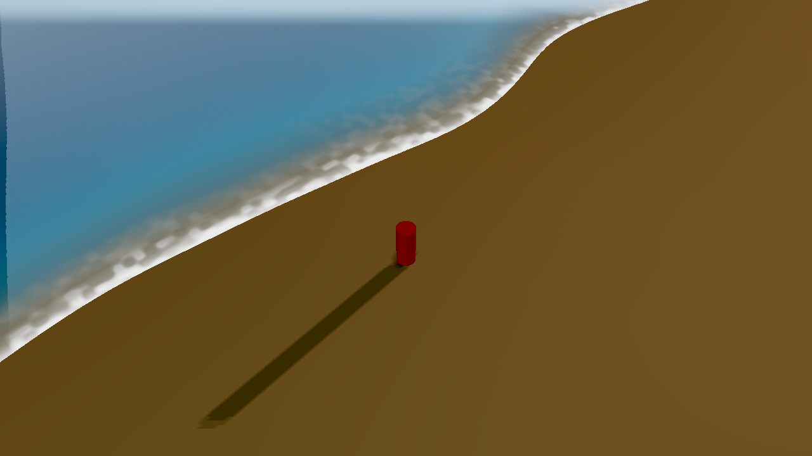
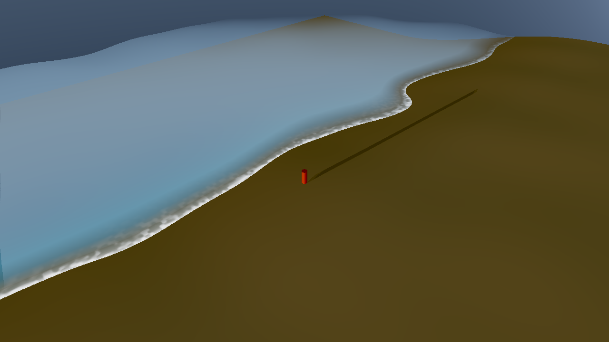
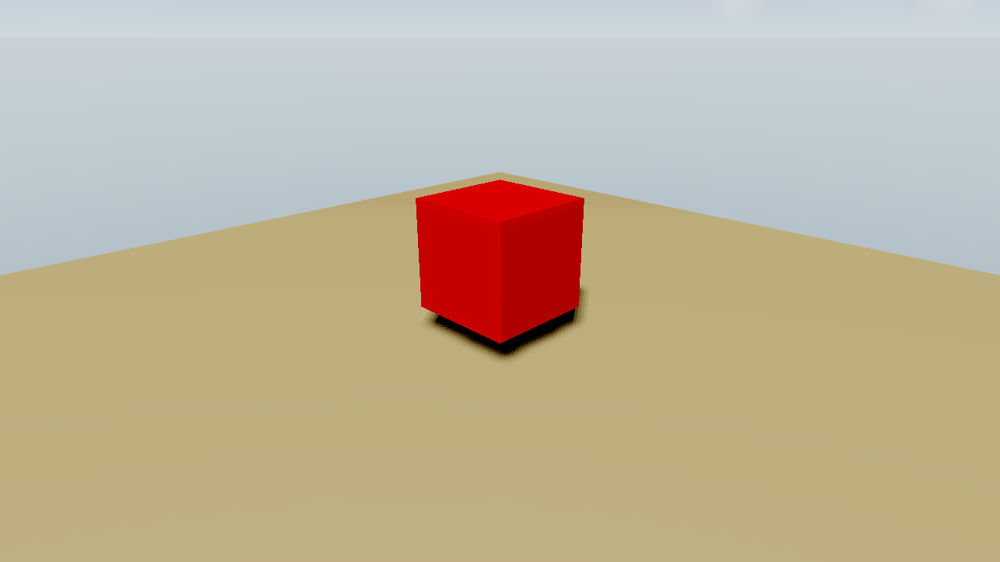

# Phase 2：昼夜核心执行记录

**日期**：2026-11-20  
**目标**：时间核心 + 太阳/月亮方向 + 天空颜色 + 环境光；不接阴影级联、不接水面联动。  
**场景**：`Assets/Scenes/RpgLab.unity`（Phase 1 相机场景）

---

## 1. 已实现

### 时间

- `TimeOfDaySystem`：
  - 0–24h、day、season
  - 连续推进
  - `gameMinutesPerSecond=1`（24 现实分钟一天）
  - 暂停 / 调速 / `SetTime` / 拖时间条
  - 调试 HUD：显示时间/Day/Season，滑块、Pause、倍速

### 太阳/月亮

- 太阳赤纬按季节/日期近似
- 太阳方位/高度由纬度 35° + 时角计算
- 方向光旋转 = 太阳方向
- 太阳强度/颜色按高度插值（低角度偏橙）
- 月亮方向与太阳相对，夜晚强度淡入

### 天空

- `FenglingSkybox` 增加：
  - `_MoonDirection` / `_MoonColor` / `_MoonSize`
  - `_NightFactor`
  - `_StarIntensity`
- 夜晚天空变暗、月亮光晕、星星
- 时间系统驱动：
  - `_ZenithColor` / `_HorizonColor`
  - 云颜色/暗部
  - 天空盒实例化，不改共享材质

### 环境光

- 时间系统改用 Flat Ambient
- `FenglingLit` 增加 `_FenglingAmbientColor` / `_FenglingAmbientScale` 全局
- 避免自建 SRP 下 Skybox SH 不随天空刷新导致夜晚仍亮

---

## 2. 验收截图

6:00：

12:00：

18:00：

0:00：

---

## 3. 已验证

- 拖时间/SetTime 后太阳方向变化；
- 玩家影子方向随时间变化（6/18 长影，12 短影）；
- 天空颜色随时间变化；
- 夜晚天空变暗；
- 24h 循环时间推进代码可用；
- 没有改阴影级联/水面时间联动。

---

## 4. 已知问题

1. **6:00 / 18:00 地面太暗**：低太阳高度 + 环境光不足，需要调 dawn/dusk ambient/exposure 曲线。
2. **0:00 水面仍偏亮蓝**：水面材质/反射还没接时间系统，属于 Phase 4。
3. **星星/月亮在截图里不明显**：当前 RTS 相机俯角 35°，天空占比小；需要单独天空截图或降低俯角验证。
4. **阴影仍是单级**：长影边缘很硬/很长，Phase 3 做 4 级级联和 bias。
5. 六套 Preset 还没接时间系统，仍在 RpgLab。

---

## 5. 下一步

1. 调 dawn/dusk ambient/exposure，让 6:00/18:00 地面可读；
2. 用天空视角验证月亮/星星；
3. 进入 Phase 3：太阳 4 级级联 + 月亮 shadow map；
4. Phase 4 再让水面高光/反射跟随太阳/月亮。

---

## 6. 环境光二次调整

- 增加 twilight 因子（日出/日落前后抬环境光）；
- `_FenglingAmbientScale` / `_FenglingAmbientColor` 用 twilight + dayFactor 混合；
- 结果：6:00/18:00 地面从死黑变为可读的暗橄榄色，但仍偏暗；
- 夜晚仍保持低环境光，避免变成白天。

后续需要单独调一套 dawn/dusk 曝光/色温曲线，不能只靠 ambient 提亮。

---

## 7. 影子长度修正（参考成熟项目）

问题：

- 6:00/18:00 太阳高度≈0，物理上影子长度趋近无限；
- 线性 shadow map 会把这个“长矛”完整画出来，视觉不可接受。

成熟项目做法：

- 不直接使用物理太阳方向作为光照方向；
- **给光照方向一个最低仰角**（常见 8–12°），天空太阳仍保留真实高度；
- 低太阳时**淡化 shadow strength**；
- 用 shadow distance/级联限制阴影范围；
- 级联只解决清晰度，不解决长度。

参考：

- [Megacity day/night cycle](https://github.com/dzautner/megacity/blob/3e546d92d7fc83df51408e4f4c04b7de2416999f/crates/rendering/src/day_night.rs)
- [Unity Shadow Cascades](https://docs.unity3d.com/es/2020.2/Manual/shadow-cascades.html)

实现：

- 光照/阴影方向最低仰角 **12°**；
- 天空太阳盘仍用真实太阳方向；
- `_FenglingShadowStrength` 在 `lightDir.y` 低时淡出；
- `FenglingLit` 用 `lerp(1, shadow, strength)`。

结果：

- 18:00 长矛消失，变成约 8–10m 的正常长影；
- 6:00 阴影被淡出，接近无影；
- 12:00 短影不变；
- 阴影距离仍 80m。

代价：

- 6:00 阴影太淡，需要继续调 fade 曲线或给角色补 contact/blob shadow；
- 这仍然是单级阴影，4 级级联另做。

---

## 8. 低太阳影子复验 + contact shadow

复验机位拉近到 distance=24、pitch=45：

- 6:00 影子约 6–8m，不再是拖到屏幕外的长矛；
- 18:00 影子方向反转，长度正常；
- 12:00 短影不变；
- 玩家脚下增加 `PlayerBlobShadow`：贴地半透明接触阴影，真实 shadow 太淡时兜底。

当前取舍：

- 真实 shadow 在 6:00/18:00 已经可见，blob 主要作为极端角度/阴影丢失时的兜底；
- 还没有 contact shadow 的独立对比截图；
- 4 级级联仍未完成。

---

## 9. 4 级级联阴影跑通

上次失败根因：

- `ComputeDirectionalShadowMatricesAndCullingPrimitives` 的 cascade ratios 传了 `Vector3.zero`；
- 正确比例应为 `(0.1, 0.25, 0.5)`；
- 级联选择改用 `splitData.cullingSphere`，不再用相机深度。

实现：

- 4 张独立 RFloat 线性深度图（1024）
- 每级 `ComputeDirectionalShadowMatricesAndCullingPrimitives(..., CascadeCount, ratios, ...)`
- `DepthOnly` 分别渲染
- shader 用 culling sphere 选级联
- 保留低太阳 shadow strength 淡出

验证：

- ShadowLab Cube 有阴影；
- RpgLab 12:00 短影、18:00 长影正常，不再消失。

### 当前

- 太阳 4 级级联已生效
- 分辨率 1024/级，4 张图
- 每帧 4 次不透明 DepthOnly 绘制
- **月亮阴影还没接**
- 性能还没采样

### 下一步

1. 月亮单独 shadow map
2. 级联按需更新
3. 720p 性能采样
4. 水面时间联动

---

## 10. 月亮光照

已完成：

- `TimeOfDaySystem` 直接写 `_FenglingMoonDir` / `_FenglingMoonColor`，不再依赖阴影类查找 Moon Light；
- 月亮强度上限 3；
- `FenglingLit` 增加冷色月亮漫反射；
- 夜间环境光从 `0.025` 提到 `0.07` 级别，避免午夜纯黑。

效果：

月亮阴影状态：

- 单独 1024 RFloat moon shadow map 已搭好；
- 但投影方向在两个版本间不稳定：
  - 一个方向：地形大面积自阴影/锯齿；
  - 另一个方向：shadow map 为空，没有阴影；
- 当前 shader **暂不乘月亮阴影**，只上月亮漫反射；
- 因此还不能宣称“月亮真实阴影完成”。

下一步：

1. 用 ShadowLab 加 Moon Light，单独 blit moon shadow map 验证内容；
2. 固定 view/proj 方向后再接回 shader；
3. 再采样性能。

---

## 11. 对照成熟项目：差距与采纳

### 我们的现状

- 4 张独立 RFloat 级联图，1024/级
- 每帧 4 次全场景 DepthOnly 绘制
- 按 culling sphere 选级联
- 4-tap PCF，固定 world bias
- 无级联混合、无距离淡出（本轮已补）
- 无按需更新（本轮已补）
- 月亮 shadow map 未接
- 水面仍独立时间系统

### 成熟项目

| 点 | 他们 | 我们 |
|---|---|---|
| 级联存储 | 单 shadow atlas tile（URP `RenderShadowSlice`） | 4 张独立图 |
| 级联裁剪 | `ShadowDrawingSettings` + splitData 每级裁剪 | 每级全场景绘制 |
| 级联过渡 | cascade blend + distance fade | 本轮补了 blend/fade |
| 更新策略 | HDRP EveryFrame / OnEnable / OnDemand 缓存 | 本轮补了按需更新 |
| 软阴影 | 5x5 PCF / 软阴影质量档 | 4-tap |
| Bias | depth bias + normal bias | 固定 world bias |
| 月亮 | 独立 shadow / 缓存 | 只有光照，阴影未接 |

参考：

- [URP ShadowUtils.RenderShadowSlice](https://raw.githubusercontent.com/Unity-Technologies/Graphics/2022.3/staging/Packages/com.unity.render-pipelines.universal/Runtime/ShadowUtils.cs)
- [HDRP shadow update mode](https://docs.unity3d.com/Packages/com.unity.render-pipelines.high-definition@16.0/manual/shadow-update-mode.html)
- [Catlike Cascade Blending](https://catlikecoding.com/unity/tutorials/custom-srp/directional-shadows/)
- [Unity Shadow Troubleshooting / Bias](https://docs.unity.cn/2021.1/Documentation/Manual/ShadowPerformance.html)

### 本轮采纳

1. **级联交界混合**：在 split 前 10% 混入下一级，减少硬切边；
2. **最远距离淡出**：shadow distance 90% 后淡出；
3. **按需更新**：太阳方向/相机位置/朝向/阴影距离基本不变时复用缓存。

验证：

### 下一步最值得采纳

1. **每级裁剪**：用 `ShadowDrawingSettings` / splitData，避免每帧 4 次全场景；
2. **软阴影/ normal bias**：先解决硬边和 acne；
3. **月亮 shadow map**：用同一套 `RenderShadowSlice` 路径，不再手写矩阵；
4. **单 atlas**：减少 RT 切换，但优先级低于裁剪；
5. **阴影质量档**：1024/2048、PCF 档位可调。

---

## 12. 每级裁剪 + normal bias

### 每级裁剪

- `ShadowCaster` pass 改为输出线性深度（`ColorMask RGBA`）
- 每级 `ShadowDrawingSettings.splitData = splitData`
- `context.DrawShadows(ref settings)` 渲染
- 这样每级只画该级 culling sphere 内的 caster，不再全场景 4 次

验证：

- ShadowLab 阴影正常
- RpgLab 12:00/18:00 阴影正常

### Normal bias

- shader 采样点沿法线偏移：
  `shadowPos = worldPos + N * _FenglingShadowNormalBias`
- normal bias = `max(0.05, distance / resolution * 1.5)`
- 减轻斜面 acne

### 已知

- `DrawShadows` 在 Unity 6000 已标记 obsolete，建议后续换 `CreateShadowRendererList` + `CommandBuffer.DrawRendererList`
- 4 张独立图仍未合 atlas
- 月亮阴影仍未接

---

## 13. 5×5 PCF 软阴影

- `SampleCascade` 从 4-tap 改成 5×5 PCF（25 taps）
- `_FenglingShadowSoftness` 控制采样半径
- 保留 normal bias、级联混合、距离淡出

结果：

- ShadowLab 方块阴影边缘明显变软
- RpgLab 18:00 长影边缘不再硬切

代价：

- 每像素最多 2 个级联（混合）× 25 taps
- 还没有质量档/距离自适应

---

## 14. RendererList 替换 DrawShadows

- 每级用 `context.CreateShadowRendererList(ref shadowSettings)`
- `CommandBuffer.DrawRendererList(rendererList)`
- 不再调用 obsolete `ScriptableRenderContext.DrawShadows`

结果：

- ShadowLab 阴影正常
- 级联/裁剪/软阴影不变

仍存在的 warning：

- `ShadowDrawingSettings.splitData` 在 Unity 6000.3 标记 obsolete，正确替代是 `ScriptableRenderContext.CullShadowCasters`
- 该 API 迁移单独做，避免一次改两层

