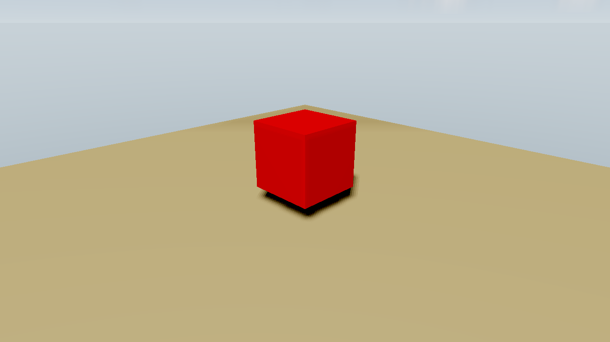
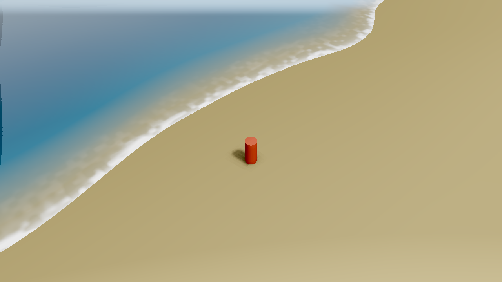
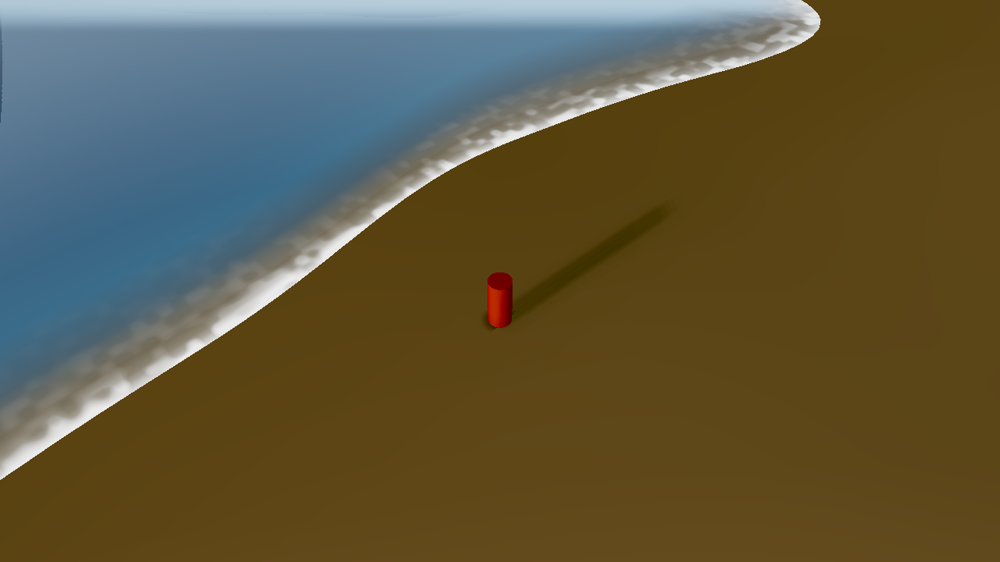

# Phase 3：统一 Directional Shadow Atlas 执行文档

**日期**：2026-11-20  
**目标**：把太阳 4 级级联与月亮 slice 统一到一张 directional shadow atlas，按 HDRP/URP 的 slice 思路实现真实月亮阴影。  
**约束**：每阶段 main 单独提交；失败回滚；不把未验证代码留主线。

---

## 参考

- [URP `ShadowUtils.RenderShadowSlice`](https://gitea.speldesign.uu.se/2025-AgileMethods/GOATtheDiver/raw/branch/main/Library/PackageCache/com.unity.render-pipelines.universal/Runtime/ShadowUtils.cs)
- [URP Shadow Cascades](https://docs.unity3d.com/es/2020.2/Manual/shadow-cascades.html)
- [HDRP Shadows](https://docs.unity3d.com/Packages/com.unity.render-pipelines.high-definition@10.2/manual/Shadows-in-HDRP.html)
- [HDRP shadow update mode](https://docs.unity3d.com/Packages/com.unity.render-pipelines.high-definition@16.0/manual/shadow-update-mode.html)

关键做法：

1. 一张 directional shadow atlas；
2. 每个 cascade / moon 是一个 tile；
3. `SetViewport(tile)` + `ShadowDrawingSettings` + `RendererList`；
4. shader 用 tile scale/offset 把局部 UV 映射到 atlas；
5. 深度比较仍在 shadow camera view depth 上做。

---

## Atlas 布局

- atlas：4096×4096 RFloat
- sun cascade 0：2048 @ (0, 0)
- sun cascade 1：1024 @ (2048, 0)
- sun cascade 2：1024 @ (2048, 1024)
- sun cascade 3：512 @ (0, 2048)
- moon：512 @ (512, 2048)

---

## 阶段

### Stage 1：atlas + 太阳 4 级

- 单 atlas 替换 4 张独立 RFloat
- 太阳 4 级按 viewport 渲染
- shader 按 tile scale/offset 采样
- 验证 12:00 / 18:00 阴影不消失、无 tile 串影

**Stage 1 结果（2026-11-20）**

- 单张 4096×4096 RFloat atlas
- sun tile：2048 / 1024 / 1024 / 512
- `SetViewport` + `ShadowDrawingSettings` + RendererList
- shader：`_FenglingShadowAtlas` + `_FenglingShadowTile0..3`
- ShadowLab 有阴影
- RpgLab 12:00 短影、18:00 长影正常
- 无 tile 串影

### Stage 2：月亮 slice

- moon light 用同一 atlas 的 moon tile
- 独立 culling / moon culling sphere
- 验证 0:00 角色月影

**Stage 2 结果（未通过）**

已实现：

- moon tile 512 @ (512, 2048)
- moon 用同一 `ComputeDirectionalShadowMatricesAndCullingPrimitives`
- `ShadowDrawingSettings` + `CreateShadowRendererList`
- `RendererList.isValid = true`
- moon light：`shadows=Soft`、`shadowStrength=1`、index 有效
- 试过 `context.DrawShadows` 旧路径

结果：

- 读回 moon tile 仍是纯色空图
- 0:00 没有角色月影
- 太阳 atlas tile 正常，说明 atlas/viewport 本身没错
- 因此第二方向光 caster 在当前 SRP 下没有真正进入 atlas

结论：

- 统一 atlas 的太阳部分保留
- 月亮 slice 回滚，不留在主线
- 真实月影需要进一步研究 HDRP 的 directional light shadow culling / ShadowDrawingSettings 初始化，不能只复用太阳路径

### Stage 3：质量回归

- 5×5 PCF / normal bias / 级联混合 / 缓存
- 按需更新是否仍有效

### Stage 4：Preset QA

- 六套 Preset 6/18/0
- 720p 性能采样

---

## 验收

- 太阳 4 级阴影正常，无 atlas tile 串影
- 0:00 月亮有真实角色阴影，不再大三角
- 六套 Preset 可运行
- 每阶段一次提交
