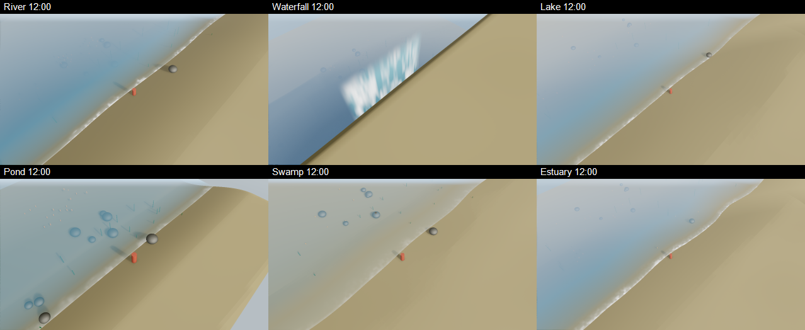
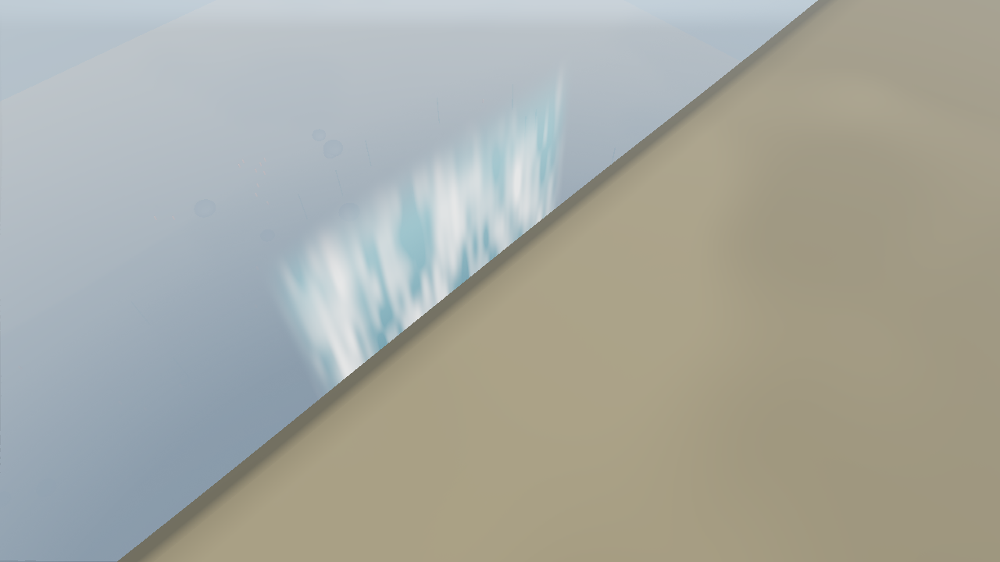
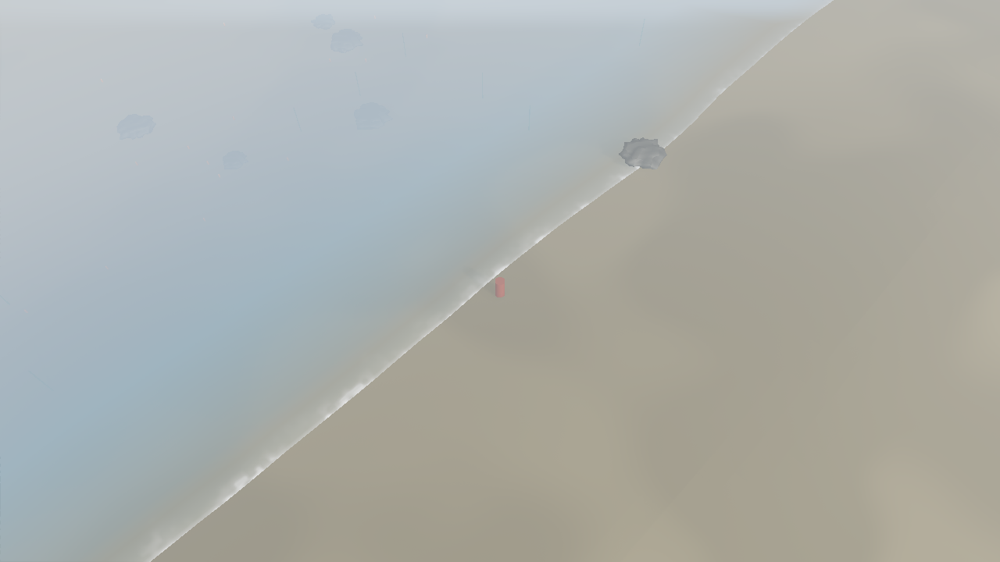
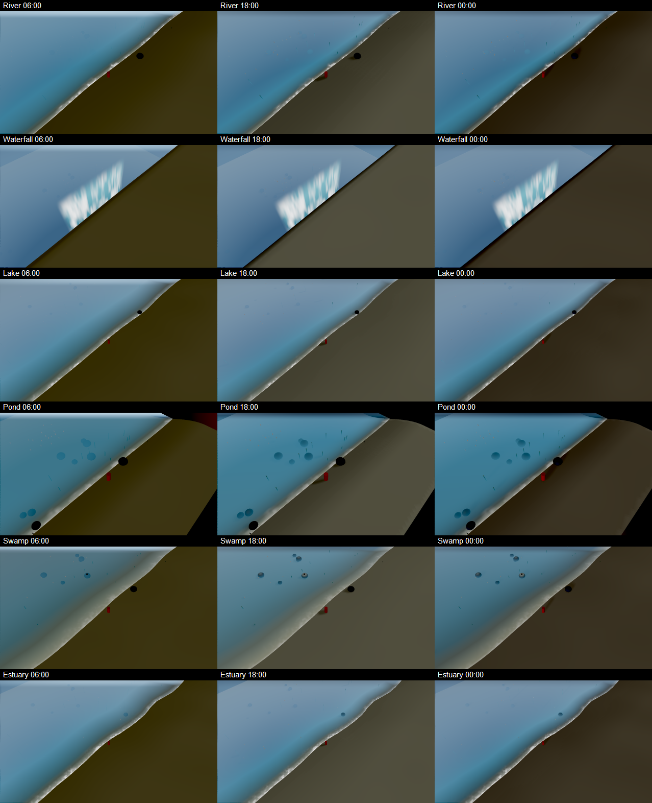

# 六套 Preset 三时段 QA

**日期**：2026-11-20  
**状态**：FAIL / WIP  
**场景**：River / Waterfall / Lake / Pond / Swamp / Estuary  
**时段**：6:00 / 18:00 / 0:00 + 补测 12:00

---

## 结论

六套场景都能出图，但**视觉不通过**。

### 1. 6/18/0 全是夜间

11 月 20 日：

- 6:00 太阳未出
- 18:00 太阳已落
- 0:00 夜间

日志确认：

```text
set 6  -> sun=0 moon=0
set 18 -> sun=0 moon=2.43
set 0  -> sun=0 moon=2.23
```

所以三张几乎一样，都是月光/环境光，不是“三时段”。

### 2. 12:00 过曝/发白



- Waterfall 直接白掉
- 其他场景水面/天空发灰白
- 对比度过低

### 3. 黑斑/灰球

- 夜间地面/水面上有黑色圆斑
- 白天变成灰球
- 已确认不全是 blob shadow：
  - 玩家 blob 已改为“真实太阳/月影越强越淡”
  - 剩余灰球更像 PropRock/PropFish 的 E4 美术异常

### 3.1 Waterfall 白掉修复

`WaterfallSheet`：

- foamStrength 2.4 → 0.65
- normalStrength 1.6 → 1.0
- sunIntensity → 1.2

Waterfall 12:00 不再纯白：



### 3.2 Rock 球体修复

`PropSpawner` 原来用 `PrimitiveType.Sphere` 生成 Rock，俯视就是灰球。

已改：

- 新增 `RockMeshFactory`
- 球体顶点按 Perlin 噪声径向位移
- 压扁 Y
- 六套场景已有 Rock 全部替换为低多边形岩石 mesh

Lake 12:00 修复后：



剩余灰球/小黑点更像 Fish/Plant 或远处小 rock，转 E4 继续。

### 4. Preset 没接天气

- 原六套场景没有 WeatherSystem
- 已补安装器：`PresetWeatherInstaller`
- 六套场景现在都有轻度云/霾（cloud 0.35 / haze 0.15 / fog 0.10）
- 接入后 12:00 仍偏白，说明不是天气缺失导致，更多是场景材质/曝光

### 5. 12:00 偏白复测

接入天气后 Lake 12:00：


仍偏白，Waterfall 白掉问题仍在。

---

## 联系表

6 套 × 6/18/0：



---

## 需要修

1. QA 时段改用 **6/12/18/0**，或按季节自动选日出/正午/日落
2. 12:00 曝光/环境光/水面亮度
3. Waterfall 白掉
4. 黑斑/灰球来源
5. Preset 接 WeatherSystem
6. 逐场景美术检查

---

## 提交

- `PresetQaCapture` 支持 6/18/0 + 12:00
- 联系表归档
