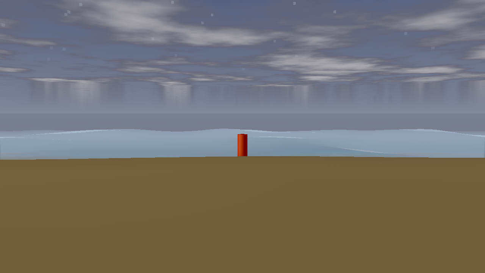
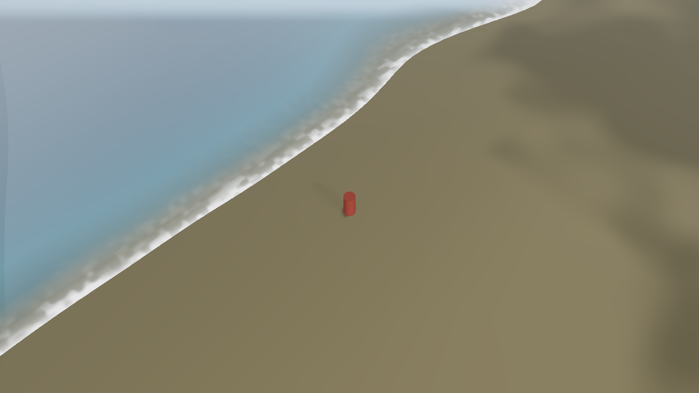
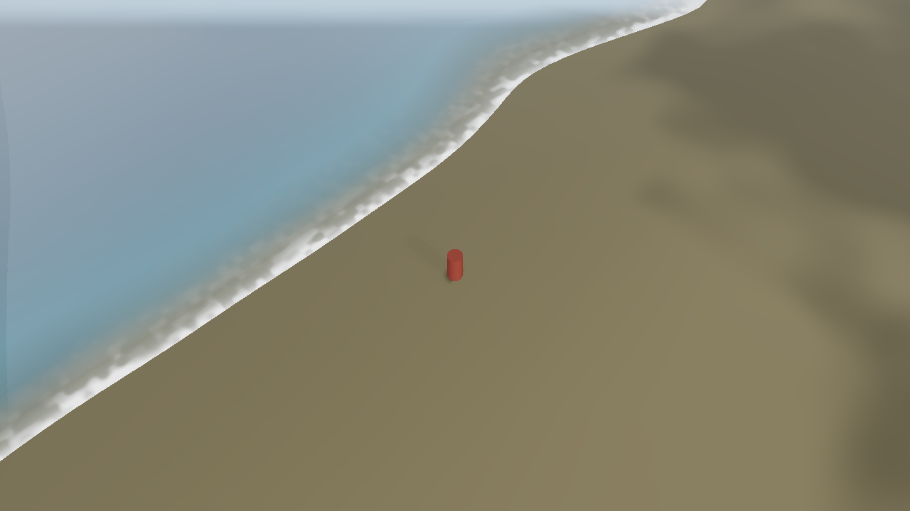

# 多层云实现记录

**日期**：2026-11-20  
**状态**：WIP（视觉层通过，云影/体积感未做）

---

## 参考

- [Fast Sky：最多 4 层 cloud layers](https://assetstore.unity.com/packages/vfx/shaders/fast-sky-dynamic-sky-shader-realistic-stylized-155281)
- [HDRP Understand clouds：Cloud Layer 用于远景，Volumetric Clouds 用于近景](https://docs.unity.cn/Packages/com.unity.render-pipelines.high-definition@17.5/manual/understand-clouds.html)
- [OverCloud 高空体积云/动态天气](https://assetstore.u3d.cn/packages/3d/environments/assetstore-package-20006599)
- [浮云卷霭：Unity 体积云 raymarching](https://zhuanlan.zhihu.com/p/2019809354270914543)

---

## 实现

`FenglingSkybox.shader` 从单层 fbm 云扩成三层：

### 远景高层云

- 平面投影：`dir.xz / max(dir.y, 0.18) * 0.35`
- 慢速漂移
- 稀疏、偏白
- 主要分布在高空

### 中景主云

- 原主云层
- `_CloudCoverage` / `_CloudOpacity` / `_CloudScale`
- 天气云量主驱动

### 近景低云/雾

- 投影更贴地平线：`dir.xz / max(dir.y, 0.05) * 2.8`
- 移动更快
- 偏暗
- 地平线带 mask

---

## 参数

- `_CloudFarCoverage` / `_CloudFarOpacity`
- `_CloudNearCoverage` / `_CloudNearOpacity`
- 由 `TimeOfDaySystem` 按 `cloudCover` 驱动：
  - 阴天远云更满
  - 近云更重

---

## QA

16:30、cloudCover=0.72、低机位：

可见：

- 高空层状云
- 中景团块云
- 地平线低云/雾带
- 地平线附近 GodRay 竖向散射

---

## 云影 / 云受光 / 风向（2026-11-20）

### 云影投地

`FenglingLit.shader` 增加 `CloudShadowFactor(worldXZ)`：

- 3 层 value noise
- `_FenglingCloudShadowScale`
- `_FenglingCloudShadowStrength`
- 风向偏移 `_FenglingCloudWind`
- 乘到太阳直射 shadow 上

阴天 QA：

水面云影：

- `FenglingWater.shader` 复用同一套 `CloudShadowFactor`
- 乘到太阳高光
- 阴天水面本来高光很弱，视觉变化小

### 云层受光

- 云颜色按太阳高度/亮度混合
- 日落时云边缘叠 `_SunColor`
- 远/中/近三层分别处理

### 风向

- skybox 三层云都用 `_CloudWind.xy` 偏移
- 不再是固定对角漂移

---

## 已知问题

1. 仍是 **2D skybox 平面投影**，没有真实高度/视差/体积感
2. 没有云影投到地面
3. 没有云层受太阳方向照明（只有亮/暗两种颜色）
4. 三层云都是 fbm，成本约 15 次噪声采样
5. 低云与 GodRay 叠加时地平线会出现竖向条纹
6. 没有风向参数

---

## 下一步

1. 云影投地（低频 shadow map/屏幕空间）
2. 日落云色/逆光边缘
3. 风向
4. 半分辨率/性能
5. 远景云和 GodRay 的合成顺序

---

## 提交

- `FenglingSkybox.shader` 三层云
- `TimeOfDaySystem` 三层云参数
- `CloudCapture` QA
