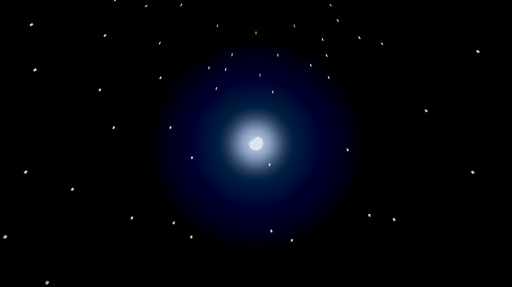
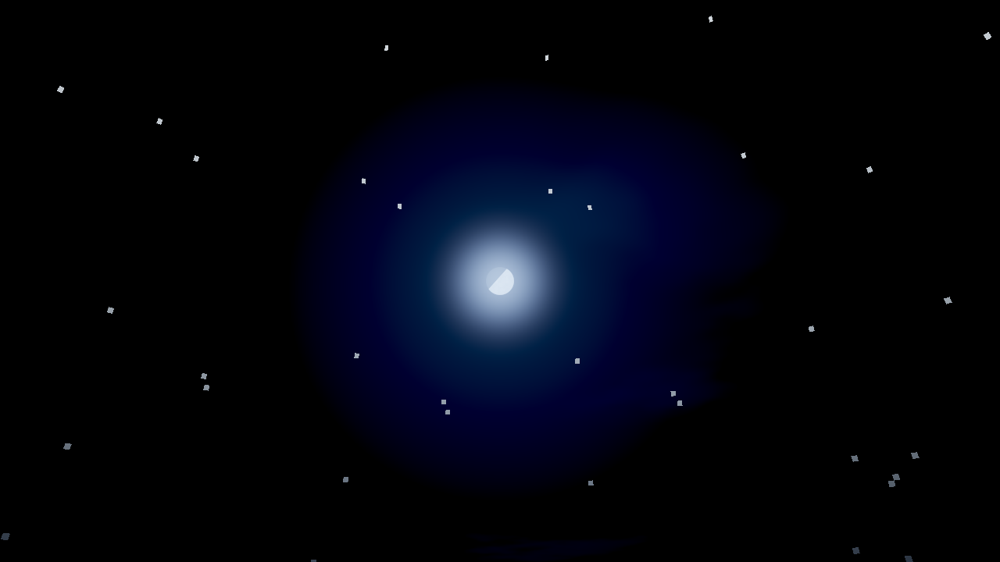
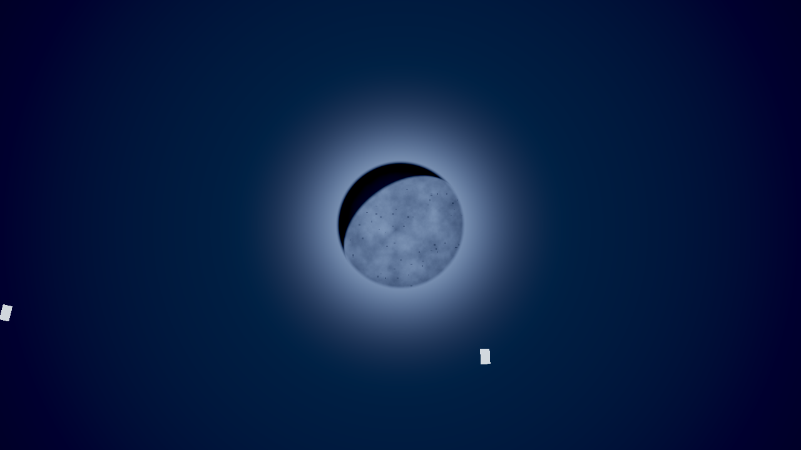
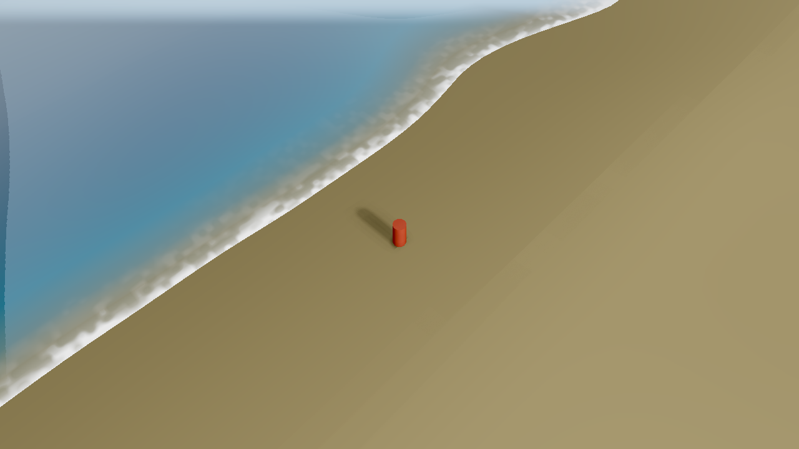
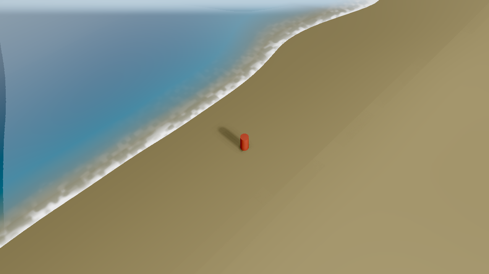

# 日月天文与视觉体系设计稿

**日期**：2026-11-20  
**状态**：设计基线，待实现  
**目标**：太阳与月亮共用一套可解释的天文时钟，驱动天空、光照、阴影、天气和月相；不只做“会转的太阳”。

---

## 1. 范围与原则

### 1.1 范围

- 1 个太阳、1 个月亮的运动
- 地球观测者看到的：
  - 太阳高度/方位/日出日落
  - 太阳颜色、强度、光晕、曝光
  - 月亮高度/方位/月相/亮面朝向/月出月落
  - 星空、银河、云、雾、天气对日月的影响
- 日月驱动的光照与阴影
- 太阳自身活动变化（视觉层）
- 天气/云量（视觉层）

### 1.2 不做

- 真实星历精度（不追求秒级/角秒级）
- 日食/月食的精确预测（可作为后续可选）
- 天气影响 gameplay（视觉 only）
- 相对论/太阳内部物理

### 1.3 原则

- 时间、位置、天气是输入；天空、光照、阴影、水面是输出
- 所有视觉参数可由时间/天气解释，不手调“看起来差不多”
- 同一套天文状态同时驱动太阳、月亮、阴影、天空、水面，避免各系统各转各的

---

### 1.4 物理链路（必须遵守）

```
太阳辐射
  → 月面反射（反照率约 0.12）
  → 月光到达地球
  → 物体遮挡月光
  → 形成月影
```

因此：

- 月亮是**次级光源**，不是“太阳影子的复制”
- 月光方向 = 从地球指向月亮；光照射线方向相反
- 月光强度 = 太阳辐照 × 月面反照率 × 月相照亮比例 × 大气/云量衰减
- 月相为新月时，月光接近 0，不应该有可见月影
- 月相为满月时，月光最强，月影最明显
- 月影的遮挡方向必须来自**月亮方向**，不能复用太阳方向

当前代码缺口：

- `TimeOfDaySystem` 目前 `moonDir = -sunDir`，不是真实月球轨道
- 月亮强度只按高度，不含月相/反照率/云量
- 月影渲染链路仍未闭环
- 太阳 swap 只能用于“复用 caster 渲染路径”，不能改变月光方向/强度

---

## 2. 天文模型

### 2.1 输入

- 日期：year / month / day
- 时间：hour / minute（本地时）
- 纬度 `latitude`
- 经度 `longitude`
- 时区/夏令时
- 天气：cloudCover、haze、fog、rain

### 2.2 太阳

使用低精度但稳定的太阳位置公式：

- 年积日 `N`
- 太阳赤纬：
  `δ = 23.44° * sin(360°/365 * (N - 81))`
- 时角：
  `H = (solarTime - 12h) * 15°`
- 高度：
  `sin(alt) = sin(lat)sin(δ) + cos(lat)cos(δ)cos(H)`
- 方位：
  由 `atan2` 求得，区分上午/下午

可选提高精度：

- 均时差 equation of time
- 地球轨道偏心率
- 大气折射（地平线附近 +0.5°）

实现优先级：

1. 当前近似公式
2. 均时差
3. 大气折射

**实现记录（2026-11-20）**

- 已加入朔望月相位：`29.53059` 天
- 月相角：`age / synodic * 2π`
- 照亮比例：`(1 - cos(phaseAngle)) / 2`
- 月亮时角：太阳时角 + 相位角
- 月亮赤纬：太阳赤纬 + `5.14° * sin(phaseAngle)`
- 月光强度：`moonMaxIntensity * altitudeFactor * illuminatedFraction`
- HUD 显示月相百分比
- 仍是低精度近似，未接 Meeus 完整月亮黄经/黄纬

**A3 更新（2026-11-20）**

已接入 `AstronomyMath`：

- 真实日期 → J2000 天数
- 太阳黄经（低精度）
- 月亮黄经（Meeus 截断项）
- 月亮黄纬
- 黄道 → 赤道 → 地平坐标
- 月相由日月黄经差计算
- 22:00 QA 月相 `0.82`，月盘亮面方向正确



### 2.3 月亮

月亮需要比“太阳反向”更完整的模型：

- 朔望月：29.53059 天
- 月球轨道倾角：约 5.14°
- 月球黄经每天约 +13.176°
- 月相角 = 太阳-地球-月亮夹角
- 被照亮比例：
  `k = (1 + cos(phaseAngle)) / 2`
- 亮面方向：从月亮指向太阳
- 月出/月落：由月亮高度曲线求零点
- 月相名称：新月/娥眉/上弦/盈凸/满月/亏凸/下弦/残月

实现建议：

- 先用“低精度月亮黄经/黄纬 + 太阳黄经”算月相和方向
- 后续可换 Meeus 低精度月亮公式
- 不引入完整 JPL 星历

### 2.4 季节

- 由太阳赤纬自然产生
- 用户已锁定：季节只影响视觉，不影响 gameplay
- 场景植被/材质变化后续单独做

---

## 3. 太阳视觉

### 3.1 太阳盘

- 角直径约 0.53°
- 临边昏暗 limb darkening
- 中心色温约 5800K，边缘偏红
- 地平线附近大气消光：偏橙红、亮度下降
- 光晕/眩光随高度和天气变化

### 3.2 天空与曝光

- 天顶/地平线颜色按太阳高度插值
- 民用/航海/天文晨昏蒙影分段
- 曝光：白天压低高光，夜晚抬暗部
- 云层对太阳盘的遮挡

### 3.3 太阳自身活动（视觉层）

- 太阳黑子：11 年周期，数量/面积变化
- 光斑 faculae
- 日珥/日冕：只在特定视角/滤镜下可见
- 对光照影响很小，主要作为“太阳不是纯白圆盘”的细节
- 不模拟耀斑对 gameplay 的影响

---

## 4. 月亮视觉

### 4.1 月相

- 月相由日月黄经差决定
- 亮面朝向太阳
- 新月：几乎不可见，只有地照
- 娥眉/残月：细弯，亮面朝太阳
- 上下弦：半圆
- 满月：完整圆盘

### 4.2 月面细节

- 月海/环形山：低对比纹理
- 临边昏暗
- 地照 earthshine：暗面微弱冷光
- 月全食红色（可选）
- 月晕（冰晶）后续天气系统

**实现记录（2026-11-20）**

- `FenglingSkybox` 增加月盘：
  - 月盘角半径
  - 亮面朝向太阳
  - 相位角切出月相
  - 暗面地照
  - fbm 月海纹理
- `TimeOfDaySystem` 把 `MoonPhaseAngle` / 照亮比例传给天空
- 22:00 QA 已验证 0.99 满月和 0.61 相位亮面



**A5 更新（2026-11-20）**

- 球面法线 `N·L` 计算月相，终止线为椭圆弧
- 临边昏暗：`limb = 0.55 + 0.45 * mu`
- 多尺度月海：fbm
- 环形山斑点：网格 hash
- 地球反照：暗面冷光
- 光晕在月盘上遮罩，避免把月面洗白
- QA 放大 FOV 12° 验证



### 4.3 月亮光照

- 月亮反照率低，颜色偏冷
- 月光强度远低于太阳
- 月光阴影应比太阳阴影软、淡
- 云量会显著降低月光和月影

---

## 5. 天气与云

### 5.1 云量

- `cloudCover 0–1`
- 云类型：晴/少云/多云/阴/雨云
- 云层高度/速度/风向
- 对太阳/月亮：
  - 强度衰减
  - 颜色去饱和
  - 阴影变软/变淡
  - 太阳盘/月亮盘被遮挡

### 5.2 雾/霾

- 能见度
- 天空对比度下降
- 日出日落颜色更红
- 阴影距离/强度下降

### 5.3 雨/雪

- 视觉粒子
- 水面波纹
- 天空更灰
- 月光/日光更弱

**B1 实现记录（2026-11-20）**

- 新增 `WeatherSystem`
  - cloudCover / haze / fog / rain / wind
  - SunVisibility / MoonVisibility / ShadowVisibility
- 云量驱动：
  - 天空 `_CloudCoverage`
  - 日月盘/光晕遮挡 `_CloudOpacity`
  - 日光/月光强度
  - shadow strength
- RpgLab 已挂 WeatherSystem
- QA：12:00 cloudCover=0.9，阴影明显衰减



**B2 实现记录（2026-11-20）**

- `WeatherSystem` 增加 `Atmosphere` / `FogDensity`
- 雾色按昼夜混合
- 雾/霾影响：
  - 天空地平线颜色
  - 太阳/月亮颜色
  - 日光/月光强度
  - 阴影强度
  - Lit 与水面距离雾
- QA：12:00 fog=0.8 / haze=0.55



**B4 实现记录（2026-11-20）**

- `_FenglingWaterCloud` / `_FenglingWaterAtmosphere` 全局
- 云量降低水面平面反射强度
- 云量降低太阳高光
- 阴天水面向雾色偏灰
- 雾继续做距离衰减


---

## 6. 光照与阴影

### 6.1 两盏方向光

- Sun Light
- Moon Light
- 各自颜色/强度由天文状态驱动

### 6.2 阴影

目标：

- 太阳：4 级级联，全场景 caster
- 月亮：与太阳同口径的全场景 caster，单独 slice
- 两张方向光阴影共用 directional shadow atlas
- 月亮阴影强度/软度低于太阳

现实限制：

- URP 不支持 additional Directional shadow
- HDRP 只允许一盏方向光投射
- 因此需要自定义双方向光 caster：
  - 自建 moon caster 列表
  - 自建 moon slice / culling
  - 不走引擎 `ShadowDrawingSettings` 对第二方向光的限制

### 6.3 阴影参数

- 太阳/月亮分别有：
  - 最低光照仰角
  - shadow strength
  - bias/normal bias
  - PCF 软度
  - 阴影距离
- 低太阳/低月亮时淡出，避免无限长影
- 天气降低 shadow strength

### 6.4 按需更新

- 太阳/月亮方向变化小、相机静止时复用阴影
- 天气/云量变化时只更新光照，不强制重画阴影

---

## 7. 系统架构

```
AstronomyClock
  ├─ SunEphemeris
  ├─ MoonEphemeris
  └─ WeatherState
        ↓
SunMoonLighting
  ├─ Sun Light
  ├─ Moon Light
  └─ SkyDomeController
        ↓
DirectionalShadowManager
  ├─ Sun Cascades
  ├─ Moon Slice
  └─ Shadow Cache
        ↓
Water / Fog / PostFX
```

### 7.1 组件

- `AstronomyClock`：日期/时间/经纬度/时区
- `SunMoonEphemeris`：太阳/月亮位置、月相、月出月落
- `WeatherSystem`：云量/雾/雨/风
- `SkyDomeController`：天空颜色、太阳盘、月亮盘、星星、云
- `SunMoonLighting`：两盏方向光、环境光、曝光
- `DirectionalShadowManager`：太阳级联 + 月亮 slice + 缓存
- `WaterSurfaceRenderer`：接收日月方向/颜色/强度

### 7.2 数据流

- 每帧只算一次天文状态
- 天空/光照/阴影/水面读同一份状态
- 不在各 shader 里重复算太阳位置

---

## 8. 验收

### 8.1 天文

- 6:00 日出方向正确
- 12:00 太阳最高
- 18:00 日落方向正确
- 月亮月相与日期对应
- 月出/月落时间合理
- 满月整夜可见

### 8.2 视觉

- 太阳盘有大小/颜色/临边昏暗
- 月相亮面朝向太阳
- 云量遮挡日月
- 夜晚有星空/银河
- 月光冷色、阴影淡

### 8.3 阴影

- 太阳 4 级级联正常
- 月亮全场景真实阴影
- 低角度长影被限制/淡出
- 天气降低阴影强度

---

## 9. 里程碑

1. 天文时钟 + 太阳/月亮位置 + 月相数据
2. 太阳盘/月亮盘/星空 shader
3. 天气/云量状态
4. 自定义双方向光阴影
5. 水面/雾/曝光联动
6. 六套 Preset 三时段 QA

---

## 10. 参考

- NOAA Solar Calculator / Solar Geometry
- TimeAndDate Moon Phases
- Meeus, Astronomical Algorithms（低精度章节）
- Unity URP/HDRP Shadow 文档
- HDRP `HDShadowManager`（单方向光限制）
