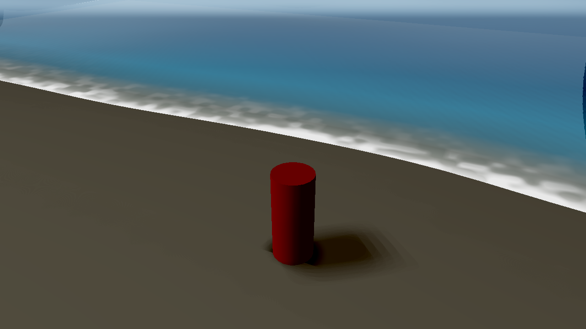

# 月亮真实阴影实现记录

**日期**：2026-11-20  
**状态**：DONE（视觉验证通过，性能未测）  
**路线**：独立 2048 月亮 shadow map，全场景 caster

---

## 参考

- [Catlike Coding Custom SRP：支持多盏带阴影的方向光，独立 DirectionalShadows](https://catlikecoding.com/unity/custom-srp/7-1-0/Custom-SRP-7-1-0.pdf)
- [Unity HDRP/URP：只有主方向光能投阴影，附加方向光不支持](https://discussions.unity.com/t/2-or-more-directional-lights-simultaneously/878090/2)
- [Universal/multiple directional lights #4451：Additional Directional Lights don't cast shadows](https://github.com/Unity-Technologies/Graphics/commit/0e17f5d5bd9cbcb55462b865b6fa12314905f1cf)
- [CryEngine Shadows：方向光（太阳/月亮）单独分类](https://www.cryengine.com/docs/static/engines/cryengine-3/categories/1114113/pages/19380385)

结论：

- 不能依赖引擎的第二方向光 shadow
- 自定义 SRP 可以自己渲染第二张方向光 shadow map
- 和太阳 atlas 分开，避免抢 tile/布局

---

## 实现

`FenglingShadows` 新增：

### 独立 moon map

- `2048 × 2048 RFloat`
- 线性深度，和太阳 ShadowCaster 共用
- `_FenglingMoonShadowMap`

### 月亮 light 选择

- 从 `culling.visibleLights` 里找：
  - Directional
  - 不是 `RenderSettings.sun`
  - `shadows != None`
  - `intensity > 0.02`
- 用 moonlight 的 light index 调：
  `ComputeDirectionalShadowMatricesAndCullingPrimitives(lightIndex, 0, 1, ratios, 2048, 0.1f, ...)`

### 绘制

- Clear 到 1000
- 设置 moon view/proj
- `ShadowDrawingSettings` + `CreateShadowRendererList`
- `DrawRendererList`
- 全场景可见 caster

### Shader

Lit shader 已有：

- `_FenglingMoonShadowMap`
- `_FenglingMoonShadowView/Proj`
- `_FenglingMoonShadowTexel`
- `_FenglingMoonShadowSphere`
- `_FenglingMoonShadowEnabled`

现在这些 global 真正被填上。

---

## QA

22:00、晴天、低机位对角色：

- 角色地面出现真实月影
- 阴影方向来自月亮，不是太阳
- 白天太阳阴影不受影响

---

## 已知问题

1. 每帧更新，未做按需缓存
2. 单级，没有 cascade
3. 只包含相机可见 caster，不是严格“全场景离线 caster”
4. 月亮阴影软度/强度没有独立参数
5. 2048 map 性能未测
6. 低月亮角度/月相很小时没有额外淡出

---

## 下一步

1. 按需更新/缓存
2. 月影软度/强度/低角度淡出
3. 720p 性能
4. 与太阳阴影同屏的稳定性测试

---

## 提交

- `FenglingShadows.RenderMoonShadow`
- Pipeline 在太阳阴影后渲染 moon map
- `MoonShadowCapture` QA
