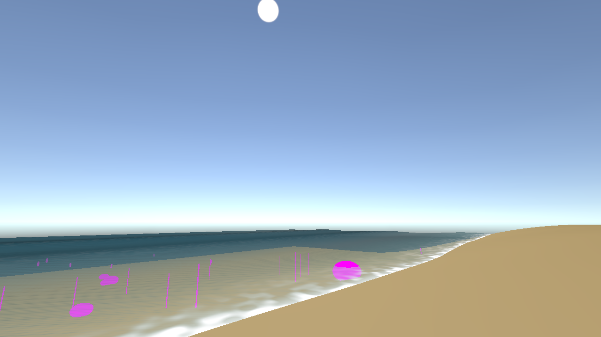
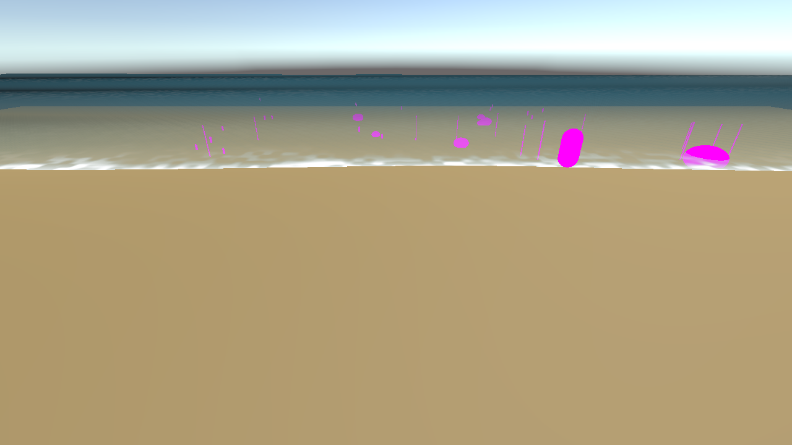
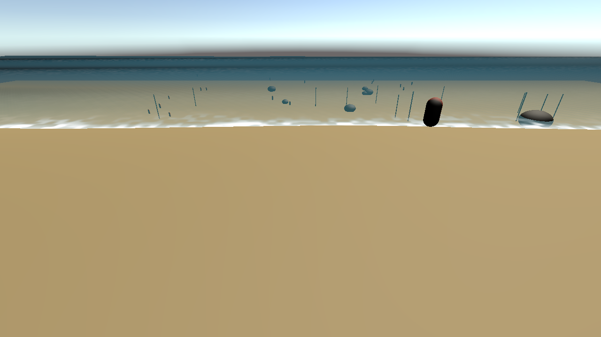
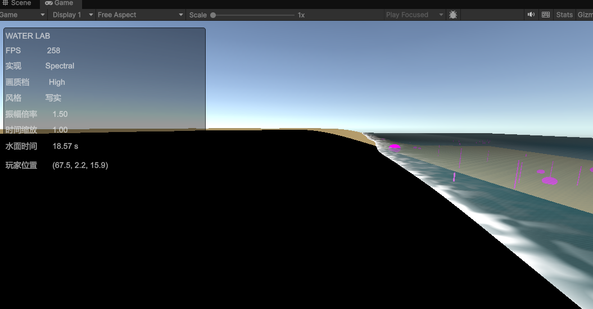
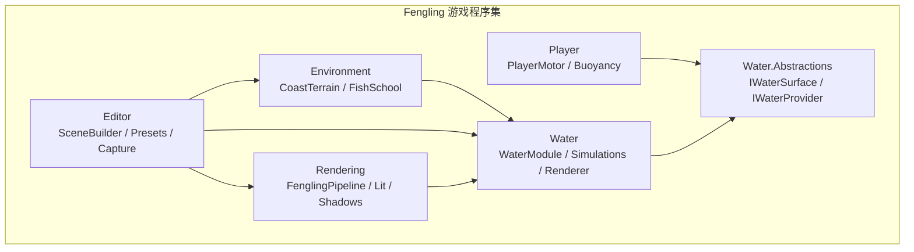
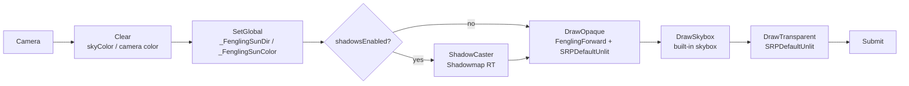
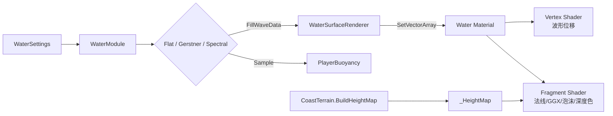

# 水体项目全面分析报告

**日期**：2026-11-19  
**工程**：`D:\item\game\My project`  
**版本**：Unity 6000.3.28f1，HDRP 17.3.0 已安装，但当前激活的是自建 `FenglingPipeline`  
**当前提交**：`fb11cde fix(srp): 默认关闭阴影开关`  
**分析范围**：水模块、自建 SRP、7 个场景、材质/光照/构建链路，以及与 Crest、Tessendorf FFT、SIGGRAPH 分享、MelodyRenderPipeline 的对照

> 后续执行清单见：[P0 问题清单与修复方案](P0问题清单与修复方案_2026-11-19.md)。
>
> **2026-11-19 P0 更新**：P0-1~P0-7 已在分支 `p0-water-fixes` 落地，Windows x64 Player 构建通过（0 errors / 5 warnings）。P0 后按“可玩垂直切片”约 **55%**，按“可上线”约 **25%**；Crest 级海洋仍约 **20%**。P1 第一项为平面反射。

---

## 0. 五问五答（先看结论）

| # | 问题 | 结论 |
|---|---|---|
| 1 | 鱼和石头为什么是紫色？ | 不是“紫色调色”，是 Unity 的 **洋红错误材质（#FF00FF）**。WaterLab 场景里的 42 个道具仍在用 **HDRP/Lit** 的嵌入式材质；自建管线只认 `FenglingForward` / `SRPDefaultUnlit`，HDRP/Lit 没有可用 pass，Unity 回退到错误 shader。 |
| 2 | 海滩附近为什么黑？ | 你截图里那块**大黑块**是自建阴影 pass 的误判：阴影图格式/投影/采样不对，地形被整片判进阴影。提交 `fb11cde` 已默认关闭阴影，当前截图不再出现。**人物本身发黑是另一件事**：Player 还用 HDRP 默认材质，且角色逆光、环境光很弱、没有后处理提亮。 |
| 3 | 水现在开发到哪一步？ | P0 前按“可玩垂直切片”约 **45%**；P0 后约 **55%**。按“Crest 级海洋”仍约 **20%**；按“可上线”从 **15%** 提升到约 **25%**。骨架、地形、水面 shader、7 个场景、材质迁移、后处理、Player 构建都已闭环；仍缺 FFT、LOD、平面反射、水下、性能验收。 |
| 4 | 快速傅里叶变换（FFT）怎么用于海洋？ | 现在**不是 FFT**，是 12 个频点的稀疏正弦求和。真 FFT 是在 GPU 上对 `N×N` 频谱做逆变换，得到高度/位移/法线三张纹理，再配三波段 LOD。当前项目应先修材质/场景/管线，再决定是否上 FFT；以现在的俯视浅水方向，FFT 不是第一优先级。 |
| 5 | 项目和水管线到底是什么情况？ | 一句话：**“HDRP 的资产 + 自建 SRP 的渲染器”半迁移状态**。水模块的接口分层是亮点，但管线只完成了“清屏 → 不透明 → 天空盒 → 透明”的最小前向，缺深度、后处理、反射、阴影、LOD，且构建期 shader 保留有风险。 |

---

## 1. 证据与现状快照

### 1.1 实际运行环境

用 Unity 批处理打开 WaterLab 并抓取一帧，得到的关键事实：

```text
RP        = Fengling.Rendering.FenglingPipelineAsset / FenglingPipeline
ambient   = Skybox, intensity 1
sun       = Directional Light
skybox    = Default-Skybox
shadow    = _FenglingShadowEnabled = 0
Fengling/Lit        supported=True, messages=0
Fengling/Water Surface supported=True
renderers(play) = 45
```

45 个渲染器的构成：

- 42 个道具：18 条鱼 + 14 株水草 + 10 块石头
- 1 个 `CoastTerrain`
- 1 个 `WaterSurface`
- 1 个 `Player`

其中 42 个道具和 Player 的材质是：

```text
Fish_x / Rock_x / Plant_x | PropFish / PropRock / PropPlant | HDRP/Lit
Player                    | DefaultHDMaterial             | HDRP/Lit
```

而地形和水面是：

```text
CoastTerrain | CoastSand              | Fengling/Lit
WaterSurface | WaterSurface (instance)| Fengling/Water Surface
```



> 这张图是 1280×720 的相机实拍，不是 Scene 视图。洋红只出现在道具上（Player 也是同一类旧材质，只是这张图里不在画面内），地形/水面正常，说明不是全局 shader 编译失败，而是**这些对象用错了 shader**。

### 1.2 一个关键时间线

- 11 月 18 日 17:26，`WaterLab.unity` 最后一次保存。
- 11 月 19 日 08:xx，工程切到自建 `FenglingPipeline`，并批量转换 `.mat` 材质。
- 11 月 19 日 10:13，`ScenePresets.BuildAll` 重建了六个预设场景。
- **WaterLab 没有重建**，所以它仍保留切换前的 HDRP 材质。

这不是猜测：`MaterialConverter.cs` 只扫描 `AssetDatabase.FindAssets("t:Material")`，也就是**只处理 `.mat` 资产**；WaterLab 里的三个道具材质是**直接嵌在场景 YAML 里的 Material 对象**，不在扫描范围内。

---

## 2. 问题 1：鱼和石头为什么是“紫色”

### 2.1 先纠正颜色：这是洋红，不是紫色

截图里的颜色是标准 `#FF00FF` 洋红，Unity 的“缺失/不兼容材质”回退色。真正的紫色会带蓝色分量和明暗变化，而这里是纯色平涂，连光照都没有。

### 2.2 根因链

```text
WaterLab 场景里的 PropFish / PropPlant / PropRock
  → 是场景内嵌 Material（不是 .mat 资产）
  → 仍引用 HDRP/Lit（guid 6e4ae4064600d784cac1e41a9e6f2e59）
  → 当前管线是 FenglingPipeline，只绘制：
       FenglingForward
       SRPDefaultUnlit
  → HDRP/Lit 没有这两个 LightMode 的 pass
  → Unity 回退到 Hidden/InternalErrorShader
  → 洋红
```

`Fengling/Lit` 本身是好的：`supported=True`，`ShaderUtil.GetShaderMessages` 为 0 条。所以不要再去查 shader 语法，问题在**材质引用**。

### 2.3 为什么只有 WaterLab 中招

六个预设场景（Estuary/Lake/Pond/River/Swamp/Waterfall）在 10:13 被 `BuildAll` 重建过，道具使用外部资产：

```text
PropFish.mat  guid 82e328716eb911a45acf29cd6feb433d
PropRock.mat  guid 3be1679bc948b7d419c223a7ec7e4e7b
PropPlant.mat guid 31ac186382452d243b01ba1c2084c12b
```

它们的 shader 都是 `Fengling/Lit`，所以不会洋红。WaterLab 是唯一一个“旧场景 + 新管线”的组合。

WaterLab 里的三个内嵌材质分别在第 1990、2914、3797 行引用 HDRP/Lit；Player 的 `DefaultHDMaterial` 在第 4351 行。它们都是切换管线前的遗留。

### 2.4 修复方式（按推荐顺序）

**方案 A：重建 WaterLab（最快）**

1. 菜单 `Fengling/Build Water Lab Scene`。
2. 重建后检查 `Props` 下每个 `MeshRenderer` 的材质名是否为 `PropFish/PropRock/PropPlant`。
3. **注意**：当前 `WaterLabSceneBuilder` 没有给 Player 指定材质，重建后 Player 仍会用默认材质。需要补一行：

```csharp
var playerMat = LitMaterialProvider.Make("PlayerBody",
    new Color(0.72f, 0.32f, 0.24f), 0.2f);
playerGo.GetComponent<Renderer>().sharedMaterial = playerMat;
```

**方案 B：做一次“场景内嵌材质迁移”**

不要只改 `MaterialConverter` 的资产扫描；还要遍历已加载场景的 `Renderer.sharedMaterial`，按名字映射到外部 `.mat`，再 `EditorSceneManager.MarkSceneDirty` + 保存。这样能保留 WaterLab 里的手工摆放。

**方案 C：加一道防回归检查**

在进入 Play 或构建前，扫描所有 `Renderer`，凡是 `shader.name` 不属于 `Fengling/*` 的，直接报错并列出对象。现在的 `RenderDebugLogger` 只打印，不阻断，容易再次漏掉。

### 2.5 这不是“鱼的材质颜色错了”

`PropFish.mat` 的 `_BaseColor` 是橙色 `(0.95, 0.62, 0.25)`，是正确的；场景根本没用它。修好后鱼会变成橙色，石头灰色，水草绿色。下面的诊断图是运行时临时替换材质的效果，证明修法有效：

| 修复前 | 修复后（运行时替换，未写回资产） |
|---|---|
|  |  |

---

## 3. 问题 2：海滩附近为什么黑

这里要拆成三个不同现象，否则会误判。

### 3.1 大块黑色地形：自建阴影 pass 的误判（已临时修复）

你给的 10:12 截图里，黑色区域有非常直的斜边，从画面左下一直切到海岸线。这种“几何直线边界”不是水的颜色，也不是光照衰减，而是**阴影投影范围/深度比较错误**的典型形状。



对应代码与问题：

| 位置 | 问题 |
|---|---|
| `FenglingShadows.cs:34` | 用 `RenderTextureFormat.Shadowmap` 建图，但 shader 里当普通 `sampler2D` 采样 `.r`；不同平台/图形 API 的深度编码不一致。 |
| `FenglingShadows.cs:51` | `Quaternion.LookRotation(-lightDirection.normalized, ...)` 的方向符号可疑：`lightDirection` 是太阳 forward（从太阳指向场景），光看矩阵应朝 `+lightDirection`，取反会让阴影相机背对场景。 |
| `FenglingShadows.cs:57` | 单级正交投影，没有级联、没有 pancaking、没有按视锥拟合，边缘很容易切出直线。 |
| `FenglingShadows.cs:66-68` | 只画 `ShadowCaster`，但没有 `context.Submit()` 把阴影图先落地，主 pass 可能在同一批次里采样未完成的 RT。 |
| `FenglingShadows.cs:80-84` | 全局 `_FenglingShadowEnabled` 一旦置 1，关闭时没有复位；`Disable()` 是空实现。 |
| `FenglingWater.shader` / `FenglingLit.shader` | 用 `shadowCoord.z` 与阴影图比较，缺少平台相关的深度线性化/bias。 |

提交 `fb11cde` 的说明写得很准确：

> 手动采 `RenderTextureFormat.Shadowmap` 的结果不可靠，导致地形整片被判在阴影里发黑。加 `shadowsEnabled` 开关，默认 false；等采样实现改对再打开。

当前默认已关闭，所以最新代码/截图不再出现这块黑。**在阴影实现改对之前，不要重新打开 `shadowsEnabled`。**

### 3.2 人物/近岸对象发黑：材质 + 逆光 + 环境光不足

大黑块修掉后，角色本身仍然可能是暗的。原因有三层：

1. **Player 还在用 `DefaultHDMaterial`（HDRP/Lit）**  
   WaterLab 的 Player 在第 4351 行引用 HDRP 包内默认材质。自建管线不认识它，最坏情况是洋红/不渲染，次坏情况是错误材质发黑。必须换成 `Fengling/Lit`。

2. **角色是逆光**  
   场景太阳旋转是 `Euler(42, -138, 0)`，光从 +X/+Z 方向来；相机从 -Z 看向 +Z，角色正面正好背光。`FenglingLit` 只有太阳漫反射 + `ShadeSH9` 环境光，没有补光、没有 rim、没有反射探针。

3. **环境光很弱，且没有后处理**  
   诊断值（线性空间）：

   ```text
   ambientProbe up   = (0.139, 0.218, 0.376)
   ambientProbe down = (0.151, 0.136, 0.121)
   ```

   对垂直的角色正面，SH 贡献只有约 0.1 量级；再乘 `_BaseColor`，几乎就是黑的。`FenglingPipeline` 没有 Exposure、ACES、Bloom、颜色分级，HDRP 的 `Global Volume`（Exposure 13.5 / ACES）**完全没被使用**。

诊断图里，把 Player 换成 `Fengling/Lit` 后仍然是一个暗红近黑的胶囊，这就是“材质修好后还黑”的证据：


### 3.3 怎么快速区分三种黑

| 测试 | 如果黑块消失 | 说明 |
|---|---|---|
| 关闭 `Player` 的 `MeshRenderer` | 黑块消失 | 黑块是角色本体/角色遮挡 |
| 把 `shadowsEnabled` 设 false（当前已 false） | 黑块消失 | 黑块是阴影 pass |
| 把相机移到地形边缘外，向海面看 | 黑块消失 | 黑块是 200m 地形/水面的边界外“空洞” |
| 把 `Fengling/Lit` 的 `_AmbientBoost` 临时调到 3 | 黑块变亮 | 黑块是环境光/逆光问题 |

### 3.4 修复建议

**短期（1 天内）**

- 保持阴影关闭。
- 给 Player 指定 `Fengling/Lit` 材质。
- 在 `Fengling/Lit` 里加一个很小的“环境光保底”：`ambient = max(ambient, _BaseColor * 0.08)`，或把 `_AmbientBoost` 默认从 1 提到 1.5–2.0。不要用纯黑作为暗部。
- 相机视角加一个顺光/侧光方向，或加一盏很弱的填充方向光（不投影）。

**中期（2–3 天）**

- 在管线里补一个真正的后处理链：Exposure → ACES → Bloom → 颜色分级。当前 HDRP Volume 里的参数要么迁移过来，要么删掉，避免“看着有 Volume 但完全不生效”。
- 阴影重做：用 `RFloat`/`Depth` + 线性深度，修正 `LookRotation` 符号，加级联和 PCF；先在一个小场景验收，再开全局。
- 如果角色仍暗，加 rim light 或 MatCap/环境反射，不要靠提高太阳强度硬拉。

---

## 4. 问题 3：水现在开发到哪一步

### 4.1 文档说的“阶段 0–7 完成”要打折扣

代码确实写到了阶段 7，但“代码存在”不等于“验收通过”。按当前工程实际状态：

| 阶段 | 文档状态 | 实际状态 | 说明 |
|---|---|---|---|
| 0 骨架 | ✅ | ✅ | 6 个 asmdef、接口、模拟器、HUD、浮力都在 |
| 1 海岸地形 | ✅ | ✅ | 128×128 程序化网格，高度函数可采样 |
| 2 水面 shader | ✅ | ⚠️ | 能出图，但波数组上传被 cap、CPU/GPU 不一致、反射探针未绑定 |
| 3 泡沫 | ✅ | ⚠️ | WaterLab 有；六个预设场景没绑 heightMap，泡沫/深度色实际是死的 |
| 4 深度色 | ✅ | ⚠️ | 同上；折射没做 |
| 4 折射 | ❌ | ❌ | 需要深度缓冲/不透明纹理，当前管线没有 |
| 5 反射 | ✅ | ❌/⚠️ | 只声明了 `unity_SpecCube0`，管线没 `SetupReflectionProbes`，实际是默认黑 cubemap 或很弱 |
| 5 焦散 | ❌ | ❌ | 没做 |
| 6 FFT | ⚠️ 改方案 | ❌ | 只是 12 个频点的正弦求和，不是 FFT |
| 7 画质档 | ✅ | ⚠️ | 代码有 Low/Medium/High，但没有帧时间/画质验收数据 |
| 自建 SRP 阶段 A | 文档写“未开始” | ⚠️ 部分完成 | 能画不透明/透明/天空盒；阴影、后处理、深度、反射都没闭环 |

### 4.2 量化

工程规模：

```text
35 个 C# 文件，2,874 行
3 个 shader，549 行
6 个 asmdef
7 个场景（WaterLab + 6 个预设）
43 次提交
0 个自动化测试（没有 NUnit/UnityTest）
```

按维度打分（主观但可解释）：

| 维度 | 完成度 | 依据 |
|---|---:|---|
| 模块/接口 | 85% | `IWaterSurface`/`IWaterProvider`/`IWaterSimulation` 分层清楚，Player 只依赖抽象 |
| 波形 | 45% | Gerstner 4 波 + Spectral 12 波；无 FFT、无水平位移、无 LOD |
| 水面着色 | 55% | 两层法线、GGX、Fresnel、深度色、泡沫、环境 cubemap 都有代码；但反射/深度/波数组上传有硬伤 |
| 场景/内容 | 45% | 7 个场景能开；六个预设缺 heightMap/normalMap，水量尺寸不对，WaterLab 材质未迁移 |
| 管线 | 30% | 最小前向 + 天空盒；无后处理、深度、反射、级联阴影、构建 shader 保留 |
| 验收/性能 | 15% | 没有 build、没有基准帧时间、没有画质验收表；HUD 的 193–258 FPS 是编辑器简单场景，不可外推 |
| **综合（垂直切片）** | **≈45%** | 能看、能走、能浮，但离“稳定可交付”还有明显距离 |
| **综合（Crest 级海洋）** | **≈20%** | 缺 FFT、LOD、平面反射、水下、泡沫反馈 |
| **综合（可上线）** | **≈15%** | 缺构建验证、性能预算、回归测试、内容一致性 |

### 4.3 六个预设场景的“隐性坏数据”

这是当前最值得先修的，不是算法：

| 场景 | 地形尺寸 | 水面实际尺寸 | heightMap | normalMap | 结果 |
|---|---:|---:|---|---|---|
| River | 120×160 | **200×200** | 无 | 无 | 水漫出地形 |
| Waterfall | 120×160 | **200×200** | 无 | 无 | 水漫出；瀑布面被替换成水平 200×200 网格 |
| Lake | 240×240 | **200×200** | 无 | 无 | 水比湖小，边缘露底 |
| Pond | 60×60 | **200×200** | 无 | 无 | 整个池塘被 200m 水覆盖 |
| Swamp | 120×120 | **200×200** | 无 | 无 | 水漫出 |
| Estuary | 200×200 | 200×200 | 无 | 无 | 尺寸对，但深度/泡沫仍失效 |

原因在 `ScenePresets.cs`：

```csharp
wm.Settings.baseLevel = p.WaterLevel;
wm.Settings.amplitudeScale = p.Amplitude;
// 没有 wm.Settings.size = p.Size;
// 没有 sm.terrainHeightMap = ...;
// 没有 sm.normalMap1/2 = ...;
```

`WaterSurfaceRenderer.Awake()` 用的是 `water.Settings.size`，默认 `(200,200)`，所以六个场景全是 200×200。`terrainHeightMap` 为 null 时，shader 采样默认黑图，`TerrainDepth` 得到约 9m 的常数水深，于是：

- alpha 接近 1，浅水不透；
- 泡沫深度掩码为 0，岸边没有泡沫；
- 深浅颜色不随地形变化。

这解释了为什么六个场景的水看起来像“一层均匀的膜”，而不是“浅滩见底、岸边有泡沫”。

另外，`BuildWaterfallSheet` 给 Quad 加了 `WaterSurfaceRenderer`，但该组件在 `Awake` 里会重建 mesh 并覆盖 Quad，所以瀑布面实际变成水平网格，垂直瀑布逻辑不成立。

### 4.4 一个会直接影响“水感”的上传 bug

`WaterSurfaceRenderer.cs:201-203` 每帧执行：

```csharp
_material.SetInt("_WaveCount", count);
_material.SetVectorArray("_WaveDirs", WaveDirs);
_material.SetVectorArray("_WaveParams", WaveParams);
```

但材质是运行时 `new Material(shader)` 创建的，shader 里数组属性默认长度是 1。Unity 6 的 Console 每帧报：

```text
Property (_WaveDirs) exceeds previous array size (16 vs 1). Cap to previous size.
Property (_WaveParams) exceeds previous array size (16 vs 1). Cap to previous size.
```

也就是说，**12 个波不一定都传到了 GPU**，很可能只传了第 1 个，或者数组被截断。Shader 里 `_WaveCount=12` 却读不到 12 组数据，轻则波形单调，重则读到未定义值。这直接破坏了文档里“CPU/GPU 同一组波参数”的核心承诺。

修复方向：

- 用 `Shader.SetGlobalVectorArray` 传全局数组，绕开 material 数组长度限制；shader 改为读全局数组；或
- 建一个 16 长度的材质资产/在首次使用前正确初始化数组；或
- 用 `MaterialPropertyBlock` 的数组接口，并在 RenderDoc 里确认 12 组都到位。

无论哪种，验收标准是：**Console 不再每帧刷这条警告，RenderDoc 里 `_WaveDirs[0..11]` 都是有效值**。

### 4.5 还有一处 CPU/GPU 不一致

Shader 的 `EvaluateWaves` 有：

```hlsl
float irregular = 1.0 + _WaveNoise * (valueNoise(xz * 0.03) - 0.5) * 2.0;
float amp = p.x * _AmplitudeScale * irregular;
```

CPU 的 `SpectralWaterSimulation.Sample()` 和 `GerstnerWaterSimulation.Sample()` 都**没有**这个 `irregular` 调制。默认 `_WaveNoise=0.35`，意味着同一位置 GPU 的振幅和 CPU 的浮力采样最多差 35%。玩家会看到“人比水面高/低”。

修复：要么删掉 shader 里的 `irregular`，要么把同样的噪声实现搬到 CPU 的 `Sample()` 里，并保证两边使用同一时间/坐标。不要只改一边。

---

## 5. 问题 4：快速傅里叶变换渲染海洋

### 5.1 Tessendorf FFT 到底在算什么

Tessendorf 的方法不是“用 FFT 生成几个波”，而是：

1. 在频域生成初始海浪谱 `h0(k)`（通常用 Phillips 谱 + 高斯随机数）。
2. 每个频率按深水色散关系演化：

```text
ω(k) = sqrt(g |k|)
h(k,t) = h0(k) e^{iωt} + conj(h0(-k)) e^{-iωt}
```

3. 对 `h(k,t)` 做 **逆 FFT**，得到空间域高度场 `h(x,t)`。
4. 对 `i k h(k,t)` 做逆 FFT，得到斜率/法线；对 `-i k/|k| h(k,t)` 做逆 FFT，得到水平位移（choppy）。
5. 用 Jacobian 或斜率阈值生成泡沫；把高度/位移/法线/泡沫打包成 RT，喂给水面 shader。

关键点：

- FFT 的 `N×N` 通常是 256×256 或 512×512；
- 需要 **三波段**（大浪/中浪/细纹）各自平铺不同 patch 尺寸，否则远景和近景不能兼顾；
- 需要 **LOD/clipmap** 网格，近密远疏；
- 需要处理 Hermitian 对称、Nyquist、平铺接缝、choppiness 自交。

### 5.2 我们现在的“Spectral”不是 FFT

`SpectralWaterSimulation.cs` 做的是：

```text
随机取 12 个波长/方向
→ 用 Phillips 公式算每个波的振幅
→ 归一化到目标总振幅
→ 在 CPU 上直接 sum A·sin(k·x - ωt + φ)
→ 把 12 组参数传给 shader，再在 vertex shader 里 sum
```

这是**稀疏的、非均匀采样的逆 DFT**，只保留 12 个频点；不是 `N×N` 的 IFFT。它没有：

- 全频带能量；
- 水平位移/choppy；
- 频域到空间域的快速变换；
- 三波段 patch；
- 泡沫 Jacobian。

所以它“数学上等价于 IFFT”的说法只在“只保留这 12 个频点、且这些频点就是全部频点”的意义上成立；对真实海面，这是一个低秩近似。它能做小池塘/湖泊，不适合开阔海平线。

### 5.3 四条路线

| 路线 | 做法 | 质量 | 成本 | 适合我们吗 |
|---|---|---|---|---|
| **A. 接 Crest** | 用 Crest 的 `ShapeFFT`、`OceanRenderer`、`LodDataMgr*`、`OceanPlanarReflection`、`UnderwaterRenderer` | 商业级 | 高；开源仓库面向 Built-in，HDRP/URP 是 Asset Store 版本 | 想要“最终质量”时考虑；接进自建 SRP 需要移植，不能直接拖进来 |
| **B. 自己写 GPU FFT** | Compute Shader 做 256² IFFT，三波段，输出位移/法线/泡沫 RT | 高 | 1–2 周（原型 3–5 天） | 推荐先做 128²/256² 单级原型，验证后再产品化 |
| **C. HDRP Water System** | 回 HDRP，用内置 Water Surface/Water System | 高 | 低（配置）+ 回 HDRP 的迁移成本 | 这台 2 核 + UHD 710 跑 HDRP 全开只有个位数 FPS，和当前性能目标冲突 |
| **D. Melody 里的 Ocean** | Melody 仓库里集成了 Crest 的海洋代码 | 高 | 不能直接抄 | 仓库没有 LICENSE，且 Ocean 目录本身就是 Crest 的副本；只能参考，不要复制 |

### 5.4 如果要做，建议这样落地

**第 0 步：先修 P0（1–2 天）**

- 材质迁移/Player 材质；
- 六个场景的 size/heightMap/normalMap；
- 关闭阴影；
- 波数组上传；
- 建立 1280×720 的基准截图和帧时间。

**第 1 步：单级 FFT 原型（3–5 天）**

- 新建 `FFTWaterLab` 场景，不动现有水。
- 256×256 频谱，Phillips 谱，`ω=sqrt(gk)`。
- Compute Shader：频谱生成 → 行 IFFT → 列 IFFT → 输出 `height`、`slope`、`displacement`。
- 水面 shader 只采样这三张 RT，不再传 16 个波。
- 验收：静帧看得到多方向、无重复条带；相机移动 30 秒无跳变；和 CPU 高度采样对得上。

**第 2 步：三波段 + LOD（5–7 天）**

- 3 个 cascade：大浪 patch 1000m、中浪 100m、细纹 10m。
- clipmap 网格（近密远疏），相邻层缝合。
- 泡沫：`Jacobian < threshold` + 噪声 + 生命周期。
- 浮力：`AsyncGPUReadback` 每 2–4 帧读回低分辨率高度，或用少量主波做 CPU 近似；不要每帧同步读整张 RT。

**第 3 步：管线配套（1–2 周）**

- 平面反射（镜像相机 + RT）；
- 深度缓冲/折射；
- 水下雾 + 焦散；
- 后处理（Exposure/ACES/Bloom）；
- 性能档 128²/256²。

### 5.5 性能判断

这台机器是 2 核 + Intel UHD 710。当前 WaterLab 的 HUD 显示 193–258 FPS，但这是：

- 编辑器；
- 1280×720 左右；
- 场景只有 45 个渲染器；
- 没有后处理、没有阴影、没有反射。

不能拿这个数字推断 FFT 的性能。合理预期：

- 128² 单级 FFT：风险低，可作为 Low 档；
- 256² 单级 FFT：中等风险，先测；
- 256² × 3 级 + 读回 + 平面反射：在这台核显上风险高，必须做降级档。

**结论：以当前“俯视浅水/池塘/河流”的方向，FFT 不是第一优先级。** 把同样的时间花在“材质迁移、场景数据、反射、后处理、泡沫”上，画面提升会更直接。只有确定要做开阔海平线/远洋，才值得上 FFT。

---

## 6. 问题 5：项目与管线的全景

### 6.1 当前架构



依赖方向是这项目最值得保留的部分：

- Player 只引用 `Fengling.Water.Abstractions`，不知道水是 Gerstner 还是 FFT；
- Water 不引用 Player；
- 加船/鱼漂只需要引用 Abstractions。

### 6.2 当前一帧的渲染流程



代码只有约 107 行，是一个**最小前向渲染器**，不是完整 SRP：

- 没有深度 prepass / `_CameraDepthTexture`；
- 没有 light probe / reflection probe 绑定；
- 没有后处理；
- 没有 planar reflection / SSR；
- 没有水下 pass；
- 没有 LOD / clipmap；
- 没有 GPU instancing / SRP Batcher 配置；
- 没有 shader variant 收集/剥离策略。

### 6.3 水面数据流



这条链有三个断点：

1. **波数组上传**：12 组波可能只到 GPU 1 组（4.4）。
2. **CPU/GPU 噪声**：shader 的 `irregular` CPU 没有（4.5）。
3. **深度来源**：`_HeightMap` 只在 WaterLab 绑定；六个预设是 null。它不是真正的深度缓冲，动态物体/重叠水面都不支持。

### 6.4 管线缺口（按优先级）

| 优先级 | 缺口 | 影响 | 建议 |
|---|---|---|---|
| P0 | 材质迁移不完整 | 洋红、角色不渲染 | 场景内嵌材质迁移 + 构建前校验 |
| P0 | 六个场景缺 heightMap/normalMap/size | 水像均匀薄膜、泡沫失效、水漫出 | 修 `ScenePresets`，重建六场景 |
| P0 | 波数组上传被 cap | 波形单调/CPU-GPU 不一致 | 改全局数组或正确初始化 |
| P0 | 构建期 shader 保留 | 打包后水面可能消失 | `renderPipelineShaderTag` 覆盖 `SRPDefaultUnlit`；水面材质落资产或 Always Included |
| P1 | 阴影误判 | 地形整片黑 | 保持关闭，重做阴影 |
| P1 | 没有后处理 | 画面灰/暗/过曝，HDRP Volume 白配 | Exposure + ACES + Bloom + 分级 |
| P1 | 没有反射探针绑定 | 水面没有天空反射，暗部黑 | `SetupReflectionProbes` 或 planar reflection |
| P2 | 没有深度/折射/焦散 | 水下物体像贴在水面 | 深度 RT + grab/折射 + 焦散 |
| P2 | 没有 LOD | 200m 固定网格，远看重复 | clipmap |
| P3 | 没有 FFT | 开阔海平线不真实 | 先原型，后产品化 |

### 6.5 与 Crest / Melody 的对比

| 能力 | 我们 | Crest | Melody |
|---|---|---|---|
| 波形 | Gerstner + 12 波稀疏谱 | Gerstner / GPU FFT 可切 | 集成 Crest 的 FFT |
| LOD | 单块 128×128 | clipmap + 连续 LOD + 水平缩放 + skirting | 有 |
| 法线 | 两层滚动 + 距离衰减 | 位移图求导 + LOD 法线 UV 缩放 | 有 |
| 反射 | `unity_SpecCube0`（未绑定） | 平面反射 + 探针 | SSR/SSSR + 平面反射 |
| 泡沫 | 深度差 + 噪声 | 浪高/梯度 + RT feedback + 生命周期 | 有 |
| 水下 | 只有整体偏青 | 完整 Underwater Renderer | 有 |
| 后处理 | 无 | 依赖管线 | Bloom/分级/outline/TAA 等 |
| 阴影 | 单级，已关闭 | 管线相关 | 级联阴影 |
| 管线完整度 | 最小前向 | 完整水系统 | 学习型全功能前向/延迟 |

Crest 的核心架构（2017/2019 分享）：

- `OceanRenderer` 调度 LOD、时间、参数；
- `ShapeGerstner` / `ShapeFFT` 作为可替换的波形输入；
- 连续 LOD clipmap + 非重叠 tile + 海平线 skirting；
- 位移/法线/泡沫写进 LOD 对应的 RT；
- `OceanPlanarReflection` 独立镜像相机；
- `OceanDepthCache` 把海底深度烘到图里；
- `UnderwaterRenderer` 单独处理水下雾/折射。

我们目前只走到了“可替换波形 + 高度图深度缓存 + 自包含水面 shader”，缺的是 LOD、平面反射、水下、泡沫 feedback 这四件工程件。

Melody 的定位不同：它是一个**学习型全功能 SRP**，README 列了 forward/deferred、级联阴影、GBuffer、velocity、PBR/toon、Bloom/分级/outline、体积云、大气、SSAO/HBAO/GTAO、SSR/SSSR、SSGI、TAA、物理相机、FFT Ocean、compute grass。它的 Ocean 目录里保留了 `Crest.asmdef` 和 Crest 脚本，说明 FFT 部分是集成的 Crest，不是自研。

**注意**：Melody 仓库没有 LICENSE（GitHub API 的 license 为 null），按默认版权保留处理，不能直接拷贝代码。Crest 核心是 MIT，但开源仓库面向 Built-in；HDRP/URP 版本在 Asset Store，使用前要确认许可和版本。

### 6.6 最大风险不是算法，是“半迁移”

当前工程同时存在：

- HDRP 包、HDRP Volume、HDRP 默认材质、HDRP Sky 资产；
- 自建 `FenglingPipeline`、`Fengling/Lit`、`Fengling/Water Surface`；
- 旧场景（WaterLab）和新场景（六预设）漂移；
- 文档说“完成”，实际有 P0 数据/上传 bug。

这会导致每次改水都像在两种管线之间打补丁。建议先做一个明确的“管线冻结周”：

1. 只修 P0，不加新功能；
2. 所有场景重新生成/迁移一次；
3. 建立截图基线 + 帧时间基线；
4. 再决定 FFT/ Crest/回 HDRP。

---

## 7. 建议的两周行动清单

### 第 1 周：把“能看”变成“可复现”

| 天 | 任务 | 验收 |
|---|---|---|
| D1 | 迁移 WaterLab 内嵌材质；给 Player 指定 `Fengling/Lit` | 45 个渲染器无 HDRP/Lit；无洋红 |
| D1 | 修 `ScenePresets`：`Settings.size`、`terrainHeightMap`、`normalMap1/2` | 六个场景水深/泡沫/尺寸正确 |
| D2 | 修波数组上传；消掉每帧 Console 警告 | RenderDoc 里 12 组波有效 |
| D2 | 修 CPU/GPU `irregular` 不一致 | 玩家脚部与水面交线正确 |
| D3 | 统一天空/环境光：`FenglingSky` 或明确用 Default-Skybox；删除/迁移 HDRP Volume | 画面不再“灰/暗”，天空与太阳方向一致 |
| D4 | 加 Exposure + ACES + Bloom（最简后处理） | 平均亮度/高光不过曝；角色暗部可见 |
| D5 | 建立 1280×720 基准截图 + 帧时间表（Low/Medium/High） | 有可比较的数字，不再靠 HUD 感觉 |

### 第 2 周：决定水的方向

| 天 | 任务 | 验收 |
|---|---|---|
| D6–D7 | 128² 单级 GPU FFT 原型（独立场景） | 多方向、无重复条带、30 秒无跳变 |
| D8 | 把 FFT 接到 `IWaterSimulation` 适配器 | Player/浮力/HUD 不改 |
| D9 | 三波段/LOD 可行性评估 | 有帧时间数据，能判断是否继续 |
| D10 | 平面反射/深度折射二选一 | 至少一个可见提升，且有性能数据 |

**如果目标是“休闲俯视水”**：第 2 周不要做 FFT，改做平面反射 + 泡沫 + 后处理，收益更大。  
**如果目标是“开阔海平线”**：第 2 周做 FFT 原型，但不要直接替换现有水。

---

## 8. 结论

1. **洋红不是颜色问题，是材质迁移问题**。WaterLab 的 42 个道具 + Player 仍用 HDRP/Lit；`MaterialConverter` 只处理 `.mat` 资产，漏了场景内嵌材质。修法明确，成本低。
2. **大黑块是阴影 pass 误判**，不是水色；提交 `fb11cde` 已默认关闭。人物发黑是材质 + 逆光 + 环境光/后处理缺失的叠加，需要单独修。
3. **进度从 P0 前约 45% 提升到 P0 后约 55% 垂直切片 / 25% 可上线**；Crest 级仍约 20%。材质、场景数据、后处理、Player 构建已闭环；剩余 P1 是平面反射、水线/海平线锯齿和瀑布崖壁。
4. **当前不是 FFT**，是 12 频点稀疏正弦求和。FFT 值得做原型，但不是当前瓶颈；以俯视浅水方向，优先平面反射/泡沫/后处理。
5. **管线是“最小前向”，不是“完整 SRP”**。它已经能画水，但缺深度、后处理、反射、阴影、LOD，且构建期 shader 保留有风险。下一步应先冻结功能、修 P0、建立基线，再决定 FFT / Crest / 回 HDRP。

---

## 附录 A：关键文件与行号

| 文件 | 关键点 |
|---|---|
| `Assets/Game/Rendering/FenglingPipeline.cs` | 107 行；`OpaqueTags` 15–24；清屏/太阳 47–65；阴影 72–78；不透明 80–89；天空盒 91–93；透明 95–102 |
| `Assets/Game/Rendering/FenglingPipelineSettings.cs` | `shadowsEnabled` 14–15，默认 false |
| `Assets/Game/Rendering/FenglingShadows.cs` | 阴影图格式 34；光看矩阵 51；绘制 66–68；全局 80–84；`Disable()` 89–92 为空 |
| `Assets/Game/Rendering/FenglingPipelineAsset.cs` | `renderPipelineShaderTag` 25 只覆盖 `FenglingForward` |
| `Assets/Game/Rendering/FenglingLit.shader` | `ShadeSH9` 89；无后处理/雾；`ShadowCaster` 124–159 |
| `Assets/Game/Water/Shaders/FenglingWater.shader` | `RenderPipeline=HDRenderPipeline` 79；`SRPDefaultUnlit` 85；`_WaveNoise`/`irregular` 200–207；`unity_SpecCube0` 300 |
| `Assets/Game/Water/Runtime/WaterSurfaceRenderer.cs` | `Shader.Find` 90；运行时材质 97；`SetVectorArray` 202–203；`_SunColor` 未设置；`_MaxWaveHeight` 212 是死属性 |
| `Assets/Game/Editor/MaterialConverter.cs` | 31 只扫描 `t:Material` 资产，漏场景内嵌材质 |
| `Assets/Game/Editor/ScenePresets.cs` | 201–202 只设 baseLevel/amplitude；未设 size/heightMap/normalMap；221–228 Player 无材质；277–294 瀑布 sheet |
| `Assets/Game/Editor/WaterLabSceneBuilder.cs` | 61–72 水面绑定 heightMap/normalMap；91–100 Player 无材质 |
| `Assets/Scenes/WaterLab.unity` | HDRP/Lit 内嵌材质 1990/2914/3797；Player `DefaultHDMaterial` 4351 |
| `Assets/Game/Water/Runtime/Simulations/SpectralWaterSimulation.cs` | 38–81 生成 12 个波；不是 FFT |
| `Assets/Game/Water/Runtime/WaterSettings.cs` | 默认 `Spectral` 59；`tier=High` 62；`spectralWaveCount=12` 81 |

## 附录 B：复现与验证

```powershell
# 1. 打开工程（不要用 -nographics，否则截不到图）
& 'D:\Unity\Editor\6000.3.28f1\Editor\Unity.exe' `
  -projectPath 'D:\item\game\My project' `
  -executeMethod Fengling.EditorTools.WaterLabAutoCapture.Capture `
  -logFile 'D:\item\game\capture.log'

# 2. 看输出
Get-Item 'D:\item\game\v2_capture.png'

# 3. 如果 Console 刷 _WaveDirs 警告，说明 4.4 的数组上传问题仍在
```

建议再加一个“构建前校验”菜单：

```text
Fengling/Debug/Validate Water Scene
  1. 所有 Renderer 的 shader 必须是 Fengling/*
  2. WaterSurfaceRenderer.terrainHeightMap != null
  3. WaterSurfaceRenderer.normalMap1/2 != null
  4. WaterSettings.size == Terrain.size
  5. Console 无 _WaveDirs/_WaveParams 警告
  6. 画面平均亮度 >= 0.35，角色正面不是纯黑
```

## 参考资料

- Crest 开源仓库（MIT，Built-in 目标；HDRP/URP 版本在 Asset Store）：  
  <https://github.com/wave-harmonic/crest>
- Crest 文档：<https://crest.readthedocs.io/en/latest>
- Jerry Tessendorf，《Simulating Ocean Water》课程笔记：  
  <https://people.computing.clemson.edu/~jtessen/reports/papers_files/coursenotes2004.pdf>
- SIGGRAPH 2017 Advances in Real-Time Rendering，Huw Bowles《Crest: Novel Ocean Rendering Techniques in an Open Source Framework》：  
  <https://advances.realtimerendering.com/s2017/index.html>  
  幻灯片：<https://advances.realtimerendering.com/s2017/Ocean_SIGGRAPH17_Final.pptx>
- SIGGRAPH 2019 Advances in Real-Time Rendering，Huw Bowles《Multi-resolution Ocean Rendering in Crest Ocean System》：  
  <https://advances.realtimerendering.com/s2019/index.htm>  
  幻灯片：<https://advances.realtimerendering.com/s2019/CrestSIGGRAPH2019-Final-for_web.pptx>
- MelodyRenderPipeline（学习型 SRP，仓库无 LICENSE；Ocean 目录集成 Crest，不建议直接拷贝）：  
  <https://github.com/4meame/MelodyRenderPipeline>
- Unity HDRP Water System（如果回 HDRP 可考虑，但本机性能风险高）：  
  <https://docs.unity3d.com/Packages/com.unity.render-pipelines.high-definition@17.3/manual/water-capabilities-of-the-water-system.html>

---

> 说明：本报告只做分析与诊断，没有修改工程资产（除 `Docs/images/` 下的诊断截图）。如果需要，我可以按第 7 节直接落地 P0 修复，并在修完后重新出一组同机位的前后对比图。
